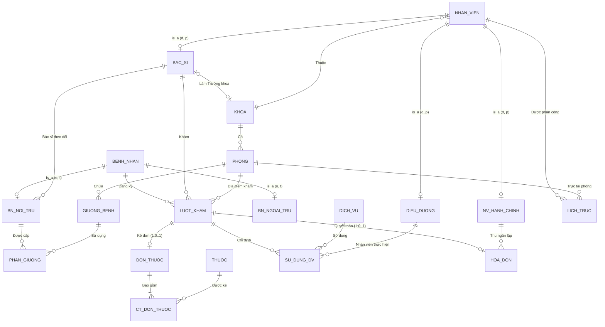

# BÁO CÁO ĐỐI CHIẾU VÀ HƯỚNG DẪN CHỈNH SỬA TOÀN DIỆN BÁO CÁO ĐỒ ÁN CƠ SỞ DỮ LIỆU NÂNG CAO
## ĐỀ TÀI: HỆ THỐNG QUẢN LÝ BỆNH VIỆN BẰNG MÔ HÌNH EER VÀ CHUẨN HÓA DỮ LIỆU
### TỆP NGUỒN CẦN CHỈNH SỬA: `doan_csdlnc_qlbv.docx` (Bản thảo báo cáo chính tại Tuần 3)

---

- **Học phần**: Cơ sở dữ liệu nâng cao (Advanced Database Systems)
- **Đơn vị đào tạo**: Khoa Công Nghệ Thông Tin – Trường Đại học Sài Gòn (SGU)
- **Giảng viên hướng dẫn**: ThS. Huỳnh Minh Trí
- **Nhóm sinh viên thực hiện**:
  1. Cao Nguyễn Quốc Khánh – MSSV: 3124410149 (Phân tích & EER)
  2. Trần Nguyễn Quỳnh Như – MSSV: 3124410258 (Tài liệu, Dữ liệu mẫu & Kiểm thử)
  3. Hoàng Văn Lập – MSSV: 3124410184 (Quan hệ & Cardinality)
  4. Nguyễn Đăng Thụy – MSSV: 3124410352 (Ràng buộc & Nghiệp vụ)
  5. Cô Thành Long – MSSV: 31244102192 (Review chéo & Hỗ trợ kỹ thuật)
- **Chức danh thẩm định**: Lead Database Architect & Senior Academic QA Auditor
- **Thời điểm rà soát**: Tháng 11/2026
- **Căn cứ đối chiếu**:
  1. Báo cáo kiểm toán chuyên sâu Tuần 1 – Tuần 4 (`BÁO CÁO KIỂM TOÁN CHUYÊN SÂU...md`).
  2. Toàn bộ hồ sơ kỹ thuật các tuần: `Tuần 1`, `Tuần 2`, `Tuần 3`, `Tuần 4` trong thư mục `docs/DataTask_PhanCongTheoTuan/`.
  3. Các file sơ đồ nguồn: `EER_Tuan1.drawio`, `EER_hoan_chinh_v1` (XML Draw.io).
  4. Bộ mã nguồn DDL SQL Server và kiểm thử: `00_Khoi_tao_va_nap_mau.sql`, `01_Doi_soat_sau_nap.sql`, `kiem_tra_tinh.py`.
  5. Tệp báo cáo Word chính của nhóm: `doan_csdlnc_qlbv.docx` (hiện có 308 đoạn văn, 4 bảng, 3 hình ảnh).

---

## MỤC LỤC BÁO CÁO RÀ SOÁT VÀ CHỈNH SỬA

1. [TỔNG QUAN HIỆN TRẠNG FILE BÁO CÁO `doan_csdlnc_qlbv.docx`](#1-tổng-quan-hiện-trạng-file-báo-cáo-doan_csdlnc_qlbvdocx)
2. [PHẦN 1: DANH MỤC CÁC CHỖ CẦN SỬA TRONG CÁC CHƯƠNG ĐÃ CÓ](#2-phần-1-danh-mục-các-chỗ-cần-sửa-trong-các-chương-đã-có)
   - [1.1. Trang bìa & Thông tin hành chính](#11-trang-bìa--thông-tin-hành-chính)
   - [1.2. Chương 1: Tổng quan và khảo sát](#12-chương-1-tổng-quan-và-khảo-sát)
   - [1.3. Chương 2: Mô hình dữ liệu quan niệm mở rộng (EER)](#13-chương-2-mô-hình-dữ-liệu-quan-niệm-mở-rộng-eer)
   - [1.4. Đánh giá chuyên sâu Sơ đồ EER (Hình 1 / image3.png)](#14-đánh-giá-chuyên-sâu-sơ-đồ-eer-hình-1--image3png)
   - [1.5. Chương 3: Chuyển đổi mô hình EER sang mô hình quan hệ & chuẩn hóa](#15-chương-3-chuyển-đổi-mô-hình-eer-sang-mô-hình-quan-hệ--chuẩn-hóa)
   - [1.6. Khắc phục triệt để Lỗi trống Khóa ngoại tại Bảng 3 (Table 3)](#16-khắc-phục-triệt-để-lỗi-trống-khóa-ngoại-tại-bảng-3-table-3)
3. [PHẦN 2: BỔ SUNG TOÀN DIỆN NỘI DUNG CÁC CHƯƠNG CÒN THIẾU](#3-phần-2-bổ-sung-toàn-diện-nội-dung-các-chương-còn-thiếu)
   - [2.1. Nội dung hoàn chỉnh cho CHƯƠNG 4: THIẾT KẾ SCHEMA VẬT LÝ VÀ RÀNG BUỘC TOÀN VẸN](#21-nội-dung-hoàn-chỉnh-cho-chương-4-thiết-kế-schema-vật-lý-và-ràng-buộc-toàn-vẹn)
   - [2.2. Nội dung hoàn chỉnh cho CHƯƠNG 5: KẾ HOẠCH VÀ KẾT QUẢ KIỂM THỬ HỆ THỐNG](#22-nội-dung-hoàn-chỉnh-cho-chương-5-kế-hoạch-và-kết-quả-kiểm-thử-hệ-thống)
   - [2.3. Nội dung hoàn chỉnh cho CHƯƠNG 6: KẾT LUẬN VÀ HƯỚNG PHÁT TRIỂN](#23-nội-dung-hoàn-chỉnh-cho-chương-6-kết-luận-và-hướng-phát-triển)
   - [2.4. Danh mục TÀI LIỆU THAM KHẢO chuẩn học thuật](#24-danh-mục-tài-liệu-tham-khảo-chuẩn-học-thuật)
   - [2.5. PHỤ LỤC ĐỒ ÁN (Appendices)](#25-phụ-lục-đồ-án-appendices)
4. [PHẦN 3: KẾ HOẠCH HÀNH ĐỘNG & CHECKLIST NGHIỆM THU TỪNG BƯỚC](#4-phần-3-kế-hoạch-hành-động--checklist-nghiệm-thu-từng-bước)

---

## 1. TỔNG QUAN HIỆN TRẠNG FILE BÁO CÁO `doan_csdlnc_qlbv.docx`

Qua phân tích cấu trúc nhị phân và nội dung chi tiết của tệp `doan_csdlnc_qlbv.docx` (tại `docs/DataTask_PhanCongTheoTuan/Tuần 3/doan_csdlnc_qlbv.docx`), hiện trạng của tài liệu như sau:

| Thuộc tính phân tích | Số lượng / Hiện trạng | Đánh giá của Lead Auditor |
| :--- | :--- | :--- |
| **Tổng số đoạn văn (Paragraphs)** | 308 đoạn | Khung sườn đã hình thành nhưng nội dung mới chỉ dừng lại ở cuối Chương 3. |
| **Tổng số bảng biểu (Tables)** | 4 bảng (Table 0 đến Table 3) | - Table 0: Bảng Business Rules (25 dòng, có lỗi gõ).<br>- Table 1: Bảng so sánh Specialization vs Generalization.<br>- Table 2: Bảng ràng buộc phân cấp (**bị bỏ trống cột ký hiệu**).<br>- Table 3: Bảng danh mục lược đồ quan hệ (**bị rỗng 100% khóa ngoại FK**). |
| **Tổng số hình ảnh nhúng (Media)** | 3 tệp (`image1.png`, `image2.jpg`, `image3.png`) | - `image1.png`: Khung viền trang bìa.<br>- `image2.jpg`: Logo Đại học Sài Gòn.<br>- `image3.png`: Sơ đồ EER tại Mục 2.3 (**đang bị lệch pha với Schema 19 bảng**). |
| **Trang bìa & Thủ tục hành chính** | 2 trang bìa lặp lại liên tiếp (Đoạn 0–37 và Đoạn 38–73) | **Dư thừa & Lỗi trình bày**: Cần xóa bỏ trang bìa trùng lặp thứ 2. |
| **Tình trạng Chương 1** | Có nội dung (Đoạn 122–185) | Tốt, nhưng có lỗi chính tả tiêu đề và mâu thuẫn tên thực thể xét nghiệm/BHYT với Chương 3/4. |
| **Tình trạng Chương 2** | Có nội dung (Đoạn 186–229) | Tốt, nhưng thiếu text dẫn giải trước Table 1/2, Table 2 rỗng ký hiệu, sơ đồ EER chưa đồng bộ. |
| **Tình trạng Chương 3** | Có nội dung (Đoạn 230–303) | Tốt về chứng minh lý thuyết, nhưng lỗi chính tả "Armtrong", "BNFC", lỗi trống FK ở Table 3. |
| **Tình trạng Chương 4: SCHEMA VÀ CONSTRAINT** | **HOÀN TOÀN TRỐNG** (Chỉ có tiêu đề tại Đoạn 304) | **THIẾU NGHIÊM TRỌNG**: Cần nạp toàn bộ nội dung từ các file `W4-A`, `W4-B`, `W4-C`, `W4-D`. |
| **Tình trạng Chương 5: KIỂM THỬ** | **HOÀN TOÀN TRỐNG** (Chỉ có tiêu đề tại Đoạn 305) | **THIẾU NGHIÊM TRỌNG**: Cần nạp Test Plan và 12 Test Cases (TC01–TC12) kiểm thử DBMS. |
| **Tình trạng Chương 6: KẾT LUẬN & HƯỚNG PHÁT TRIỂN** | **HOÀN TOÀN TRỐNG** (Chỉ có tiêu đề tại Đoạn 306) | **THIẾU**: Cần viết tổng kết kết quả, nêu 8 hạn chế P01–P08 và phương hướng phát triển. |
| **Tài liệu tham khảo & Phụ lục** | **HOÀN TOÀN TRỐNG** (Chỉ có tiêu đề tại Đoạn 307) | **THIẾU**: Cần bổ sung danh mục trích dẫn chuẩn học thuật và phụ lục mã nguồn SQL. |

---

## 2. PHẦN 1: DANH MỤC CÁC CHỖ CẦN SỬA TRONG CÁC CHƯƠNG ĐÃ CÓ

### 1.1. Trang bìa & Thông tin hành chính

- **Vị trí**: Đoạn 0 đến Đoạn 73 trong tệp `doan_csdlnc_qlbv.docx`.
- **Hiện trạng & Lỗi phát hiện**:
  1. *Lỗi nhân đôi trang bìa*: Tài liệu đang chứa **2 trang bìa liên tiếp** giống hệt nhau (Trang bìa 1 từ Đoạn 0–37; Trang bìa 2 từ Đoạn 38–73), cả hai đều chứa khung viền (`image1.png`) và logo trường Đại học Sài Gòn (`image2.jpg`).
  2. *Lỗi trình bày trang nhận xét*: Trang "NHẬN XÉT CỦA GIẢNG VIÊN" (Đoạn 74–121) chứa tới 47 dòng trống (`Normal`), chiếm nhiều trang trắng không cần thiết.
- **Cách sửa chi tiết**:
  - **Thao tác**: Xóa toàn bộ khối văn bản từ Đoạn 38 đến Đoạn 73 để loại bỏ hoàn toàn trang bìa thứ 2.
  - **Đồng bộ danh sách nhóm**: Đảm bảo trang bìa đầu tiên trình bày đúng danh sách 5 thành viên theo thứ tự phân công chuẩn của Khoa CNTT - ĐH Sài Gòn:
    ```text
    TRƯỜNG ĐẠI HỌC SÀI GÒN
    KHOA CÔNG NGHỆ THÔNG TIN
    -------------------------
    HỌC PHẦN: CƠ SỞ DỮ LIỆU NÂNG CAO
    BÁO CÁO ĐỒ ÁN
    ĐỀ TÀI: QUẢN LÝ BỆNH VIỆN BẰNG MÔ HÌNH EER VÀ CHUẨN HÓA

    Giảng viên hướng dẫn: ThS. Huỳnh Minh Trí
    Nhóm sinh viên thực hiện:
      1. Cao Nguyễn Quốc Khánh  - MSSV: 3124410149 (Trưởng nhóm / EER)
      2. Trần Nguyễn Quỳnh Như  - MSSV: 3124410258 (Tài liệu & Kiểm thử)
      3. Hoàng Văn Lập          - MSSV: 3124410184 (Chuẩn hóa & Khóa)
      4. Nguyễn Đăng Thụy       - MSSV: 3124410352 (Ràng buộc & Dữ liệu)
      5. Cô Thành Long          - MSSV: 31244102192 (Review chéo & Kỹ thuật)

    TP. HỒ CHÍ MINH, THÁNG 11/2026
    ```
  - Thu gọn trang "NHẬN XÉT CỦA GIẢNG VIÊN" thành 1 bảng nhận xét tiêu chuẩn gồm: Điểm quá trình, Điểm báo cáo, Nhận xét chi tiết, và Chữ ký của Giảng viên.

---

### 1.2. Chương 1: Tổng quan và khảo sát

#### Lỗi chính tả và thuật ngữ
1. **Tiêu đề Chương 1**:
   - *Vị trí*: Đoạn 122 (`Heading 1`).
   - *Hiện trạng*: `Chương 1: TỔNG QUAN VÀ KHẢO SAT` (Thiếu dấu sắc).
   - *Cách sửa*: Sửa thành `Chương 1: TỔNG QUAN VÀ KHẢO SÁT`.
2. **Tiêu đề Mục Danh mục quy tắc nghiệp vụ**:
   - *Vị trí*: Đoạn 184 (`Heading 2`).
   - *Hiện trạng*: `Tổng hợp danh mục quy tắt nghiệp vụ (Bussiness Rules)` (Sai chính tả tiếng Việt "quy tắt" và tiếng Anh "Bussiness").
   - *Cách sửa*: Sửa thành `Tổng hợp danh mục quy tắc nghiệp vụ (Business Rules)`.

#### Chỉnh sửa Bảng 0 (Table 0 - Danh mục Business Rules)
- **Vị trí**: Table 0 (nằm ngay sau Đoạn 184).
- **Lỗi phát hiện**:
  1. Tiêu đề cột 3 ghi sai chính tả: `BUSSINESS RULES` -> Sửa thành `BUSINESS RULES`.
  2. Dòng `BR13`: Tên thực thể trong cột Ghi chú ghi nhầm là `LOAI_PHIEU_XET` -> Sửa thành `LOAI_XET_NGHIEM` (hoặc `DICH_VU`).
  3. Dòng `BR14`: Lỗi gõ văn bản: "Một **ký thuật viên** có thể thực  hiện" -> Sửa thành "Một **kỹ thuật viên** có thể thực hiện".
  4. Dòng `BR15`: Lỗi định dạng bản số: ghi `1:0….1` (4 dấu chấm) -> Sửa thành `1:0..1`.
  5. **THIẾU QUY TẮC NGHIỆP VỤ CHO LỊCH TRỰC**: Bảng quy tắc nghiệp vụ BR01–BR24 hoàn toàn không có quy tắc nào điều chỉnh hoạt động phân công ca trực của nhân viên y tế, trong khi bảng `LICH_TRUC` lại xuất hiện trong CSDL ở Chương 3 và Chương 4!
- **Nội dung thay thế và bổ sung hoàn chỉnh cho Bảng 0**:
  - Cập nhật dòng BR13, BR14, BR15.
  - Bổ sung quy tắc nghiệp vụ **`BR25`** vào cuối Bảng 0:
    ```text
    | BR25 | NHAN_VIEN – LICH_TRUC – PHONG | Một nhân viên có thể tham gia nhiều ca trực; mỗi lượt trực gắn với đúng một nhân viên và một phòng bệnh/phòng chức năng. Tại một thời điểm (Ngày trực, Ca trực), mỗi nhân viên chỉ được phân công trực tại tối đa một phòng duy nhất. | 1:N | NHAN_VIEN Partial; LICH_TRUC Total. Khóa chính rút gọn (MaNV, NgayTruc, CaTruc) đạt BCNF. |
    ```

#### Giải quyết mâu thuẫn giữa Khảo sát quy trình và Thực thể CSDL quan hệ
- **Vị trí**: Đoạn 156–183 (Năm quy trình vận hành bệnh viện).
- **Hiện trạng**: Khảo sát mô tả thực thể `THE_BHYT`, phiếu `PHIEU_XET_NGHIEM`, `LOAI_XET_NGHIEM`, và hóa đơn `VIEN_PHI`. Tuy nhiên ở Chương 3, nhóm đã gộp BHYT vào `BENH_NHAN`, đổi tên xét nghiệm thành `SU_DUNG_DV` & `DICH_VU`, và đổi `VIEN_PHI` thành `HOA_DON`.
- **Cách sửa**: Bổ sung một đoạn "Thuyết minh chuyển dịch nghiệp vụ" vào cuối Mục 1.2 (sau Đoạn 183):
  > *"Ghi chú chuyển dịch mô hình: Trong quy trình khảo sát thực tế, dữ liệu bảo hiểm và xét nghiệm phát sinh theo phiếu rời rạc. Tuy nhiên, khi chuyển sang thiết kế CSDL quan hệ nâng cao, để đáp ứng quản lý tập trung theo mã định danh công dân (VssID) và chuẩn hóa danh mục viện phí y tế số của Bộ Y tế, các thực thể xét nghiệm được tổng quát hóa thành danh mục DICH_VU và quan hệ thực thi SU_DUNG_DV; hóa đơn viện phí được quản lý thống nhất qua thực thể HOA_DON."*

---

### 1.3. Chương 2: Mô hình dữ liệu quan niệm mở rộng (EER)

#### Chữa lỗi các đoạn văn bản rỗng tại Mục 2.1
- **Vị trí 1**: Sau Đoạn 193 (`Heading 3: Tiến trình thiết kế phân cấp`), Đoạn 194 là một dòng TRỐNG, tiếp sau đó là Table 1 (Bảng so sánh Specialization vs Generalization).
  - *Cách sửa*: Chèn đoạn văn dẫn giải vào Đoạn 194:
    > *"Trong quá trình mô hình hóa dữ liệu bệnh viện, việc xây dựng cấu trúc phân cấp thực thể có thể tiếp cận theo hai hướng: Chuyên biệt hóa (Specialization - tiếp cận Top-Down từ lớp cha khái quát xuống các lớp con đặc thù) hoặc Tổng quát hóa (Generalization - tiếp cận Bottom-Up từ các nhóm thực thể tương đồng gom thành lớp cha dùng chung thuộc tính). Bảng dưới đây so sánh đặc trưng cốt lõi của hai phương pháp luận:"*
- **Vị trí 2**: Sau Đoạn 195 (`Heading 3: Tổ hợp ràng buộc trên mô hình EER`), Đoạn 196 là một dòng TRỐNG, tiếp sau đó là Table 2 (Bảng 4 loại ràng buộc).
  - *Cách sửa*: Chèn đoạn văn dẫn giải vào Đoạn 196:
    > *"Mối quan hệ kế thừa giữa Superclass và các Subclass được định nghĩa chặt chẽ thông qua hai chiều ràng buộc trực giao: Ràng buộc phân tách (Disjointness Constraint: Disjoint 'd' vs Overlapping 'o') và Ràng buộc tham gia đầy đủ (Completeness Constraint: Total vs Partial). Sự kết hợp của hai chiều này tạo nên 4 tổ hợp ràng buộc phân cấp kinh điển trên mô hình EER:"*

#### Sửa lỗi CỘT TRỐNG RỖNG trong Bảng 2 (Table 2 - Tổ hợp ràng buộc trên mô hình EER)
- **Vị trí**: Table 2 (sau Đoạn 196).
- **Lỗi nghiêm trọng**: Toàn bộ **Cột 2 (Ký hiệu quy ước)** trong bảng này bị BỎ TRỐNG hoàn toàn!
- **Nội dung thay thế hoàn chỉnh cho Bảng 2**:

| Tổ hợp ràng buộc | Ký hiệu quy ước | Ngữ nghĩa nghiệp vụ và Quy tắc toàn vẹn | Áp dụng trong đề tài QLBV |
| :--- | :---: | :--- | :--- |
| **Disjoint & Partial** | **`[d, p]`** | **Rời rạc & Từng phần**: Mỗi thực thể cha thuộc tối đa một thực thể con, hoặc không thuộc bất kỳ thực thể con nào. | Cây `NHAN_VIEN`: Nhân viên y tế có thể là Bác sĩ, Điều dưỡng hoặc Kỹ thuật viên; các nhân sự khác (hành chính, bảo vệ) không thuộc 3 nhóm này. |
| **Disjoint & Total** | **`[d, t]`** | **Rời rạc & Toàn phần**: Mỗi thực thể cha bắt buộc phải thuộc vào đúng một và chỉ một thực thể con duy nhất. | Cây `BENH_NHAN` (theo góc nhìn lượt khám): Trong một đợt khám/điều trị, bệnh nhân bắt buộc phải thuộc diện Nội trú hoặc Ngoại trú. |
| **Overlapping & Partial** | **`[o, p]`** | **Chồng lấn & Từng phần**: Mỗi thực thể cha có thể đồng thời thuộc nhiều thực thể con khác nhau, hoặc không thuộc con nào. | Phân loại nghiên cứu đề tài chuyên môn hoặc danh hiệu thi đua của cán bộ y tế. |
| **Overlapping & Total** | **`[o, t]`** | **Chồng lấn & Toàn phần**: Mỗi thực thể cha bắt buộc phải thuộc ít nhất một hoặc nhiều thực thể con đồng thời. | Cây `BENH_NHAN` (theo lịch sử dài hạn): Một người bệnh có thể vừa có lịch sử khám ngoại trú, vừa từng nằm viện điều trị nội trú. |

#### Chỉnh sửa Mâu thuẫn logic phân cấp giữa Chương 2 và Chương 3
- **Hiện trạng mâu thuẫn**:
  1. *Cây Nhân viên*: Chương 2 (Đoạn 214) định nghĩa `[d, p]` với 3 con là `BAC_SI, DIEU_DUONG, KY_THUAT_VIEN`. Tuy nhiên, sang Chương 3 (Đoạn 246), tài liệu lại ghi là `Cây NHAN_VIEN (Disjoint, Total)` và thay con thứ ba thành `NV_HANH_CHINH`.
  2. *Cây Bệnh nhân*: Chương 2 (Đoạn 223) định nghĩa `[d, t]` (Disjoint, Total). Nhưng sang Chương 3 (Đoạn 247), tài liệu lại viết là `Cây BENH_NHAN (Overlapping, Total)`.
- **Cách sửa chi tiết**:
  - Tại Chương 2, cần giải thích rõ: Ràng buộc `[d, t]` đối với bệnh nhân là xét **trong phạm vi một đợt khám chữa bệnh cụ thể**. Tuy nhiên, trên bình diện hồ sơ dài hạn của bệnh nhân (thực thể `BENH_NHAN`), một bệnh nhân có thể trải qua cả điều trị nội trú và tái khám ngoại trú, do đó lược đồ quan hệ vật lý tại Chương 3 và 4 đã bổ sung hai cờ trạng thái `CoNoiTru BIT` và `CoNgoaiTru BIT` (mô hình hóa `[o, t]`).
  - Tại Chương 3 (Đoạn 246): Sửa lại định nghĩa `Cây NHAN_VIEN` thành `Disjoint, Partial [d, p]` để khớp tuyệt đối với lý thuyết ở Chương 2.

---

### 1.4. Đánh giá chuyên sâu Sơ đồ EER (Hình 1 / image3.png)

#### Đánh giá tính đúng / sai của Sơ đồ EER hiện tại
Sơ đồ EER trong file Word (tại Đoạn 226–228, tệp ảnh `image3.png`) được kết xuất từ tệp `EER_hoan_chinh_v1` (draw.io). Qua thẩm định kỹ thuật:
- **Ưu điểm**: Sơ đồ thể hiện rõ cấu trúc phân cấp IS-A, phân biệt đúng thực thể yếu kép (`PHAN_GIUONG`, `CHI_TIET_DON_THUOC`, `PHIEU_XET_NGHIEM`), sử dụng đúng hình oval nét đứt cho thuộc tính dẫn xuất và oval đôi cho thuộc tính đa trị `{ChungChiHanhNghe}`.
- **CÁC ĐIỂM SAI VÀ LỆCH PHA NGHIÊM TRỌNG SO VỚI LƯỢC ĐỒ 19 BẢNG**:
  1. **Lệch pha Subtype Nhân viên**: Trên sơ đồ vẽ `KY_THUAT_VIEN`, nhưng trong lược đồ quan hệ Chương 3, Từ điển dữ liệu Chương 4 và file SQL lại đổi thành `NV_HANH_CHINH`.
  2. **Lệch pha Thực thể Bảo hiểm**: Trên sơ đồ vẽ riêng thực thể `THE_BHYT` quan hệ 1:N với `BENH_NHAN`, nhưng trong CSDL thực tế bảng này bị xóa bỏ và gộp vào `BENH_NHAN(SoBHYT, MucHuongBHYT)`.
  3. **Lệch pha Thực thể Cận lâm sàng**: Trên sơ đồ vẽ hai thực thể `PHIEU_XET_NGHIEM` và `LOAI_XET_NGHIEM`, nhưng trong CSDL thực tế lại chuyển đổi thành `SU_DUNG_DV` và `DICH_VU`.
  4. **THIẾU HOÀN TOÀN THỰC THỂ `LICH_TRUC`**: Trên sơ đồ EER hoàn toàn **không có thực thể Lịch trực**, trong khi bảng `LICH_TRUC` lại là một bảng chính thức (bảng thứ 19) trong CSDL quan hệ!
  5. **Lệch pha Thực thể Viện phí**: Trên sơ đồ đặt tên là `VIEN_PHI`, trong CSDL thực tế đặt tên là `HOA_DON`.

#### Cách sửa Sơ đồ EER chi tiết
Nhóm sinh viên cần mở file `Tuần 2/EER_hoan_chinh_v1` trên công cụ [draw.io](https://app.diagrams.net) và thực hiện các điều chỉnh đồng bộ sau:
1. Bổ sung thực thể **`LICH_TRUC`** liên kết N:1 với `NHAN_VIEN` ("Phân công trực") và N:1 với `PHONG` ("Tại phòng").
2. Đổi tên thực thể `VIEN_PHI` thành **`HOA_DON`**.
3. Cập nhật nhánh cận lâm sàng thành thực thể kết hợp **`SU_DUNG_DV`** (giữa `LUOT_KHAM` và `DICH_VU`).
4. Xuất lại file ảnh PNG có độ phân giải cao và thay thế cho `image3.png` tại Đoạn 228 của file Word.

#### Mã nguồn Mermaid Sơ đồ EER Chuẩn hóa Đồng bộ 100% với CSDL
Nhóm có thể chèn trực tiếp mã Mermaid chuẩn hóa dưới đây vào báo cáo để phản ánh chính xác cấu trúc CSDL 19 bảng:



---

### 1.5. Chương 3: Chuyển đổi mô hình EER sang mô hình quan hệ & chuẩn hóa

#### Sửa lỗi chính tả và thuật ngữ học thuật
1. **Tiêu đề Mục Tiên đề Armstrong**:
   - *Vị trí*: Đoạn 250 (`List Paragraph`).
   - *Hiện trạng*: `Định nghĩa tiền đề Armtrong` (Viết sai tên nhà khoa học Armstrong và sai từ "tiền đề" thay vì "tiên đề").
   - *Cách sửa*: Sửa thành `Hệ tiên đề Armstrong (Armstrong's Axioms)`.
2. **Tiêu đề Mục Danh mục quan hệ sau BCNF**:
   - *Vị trí*: Đoạn 301 (`List Paragraph`).
   - *Hiện trạng*: `Danh mục lượt đồ quan hệ sau BNFC hoàn chỉnh` (Viết sai chính tả "lượt đồ" -> "lược đồ", và viết lộn từ viết tắt "BNFC" -> "BCNF").
   - *Cách sửa*: Sửa thành `Danh mục lược đồ quan hệ sau chuẩn hóa BCNF hoàn chỉnh`.

#### Sửa chữa lập luận toán học về Khóa tối tiểu của `PHAN_GIUONG`
- **Vị trí**: Đoạn 279–284.
- **Lỗi lý thuyết**: Tài liệu khẳng định bộ ba `(MaBN, MaGiuong, NgayBatDau)` là "Khóa chính tối tiểu".
- **Phân tích của Lead Auditor**: Theo chính quy tắc BR15 nhóm đã nêu: "Tại một thời điểm bắt đầu, 1 bệnh nhân chỉ nằm 1 giường và 1 giường chỉ chứa 1 bệnh nhân". Do đó tồn tại 2 phụ thuộc hàm:
  $$\text{FD}_1: (MaBN, NgayBatDau) \rightarrow MaGiuong, NgayKetThuc, GiaGiuongNgay, GhiChuChuyenGiuong$$
  $$\text{FD}_2: (MaGiuong, NgayBatDau) \rightarrow MaBN, NgayKetThuc, GiaGiuongNgay, GhiChuChuyenGiuong$$
  Vì vậy, bao đóng của riêng $(MaBN, NgayBatDau)$ đã phủ toàn bộ quan hệ. Việc thêm thuộc tính $MaGiuong$ vào khóa làm cho bộ ba này trở thành **Siêu khóa (Superkey)** chứ **không phải Khóa tối tiểu (Candidate Key)**.
- **Cách sửa chi tiết**: Thay thế đoạn văn từ 279–284 bằng văn bản học thuật chuẩn xác sau:
  > *"Xét quan hệ PHAN_GIUONG: Dưới các phụ thuộc hàm nghiệp vụ $FD_1: (MaBN, NgayBatDau) \rightarrow (MaGiuong, \dots)$ và $FD_2: (MaGiuong, NgayBatDau) \rightarrow (MaBN, \dots)$, quan hệ có hai khóa ứng viên tối tiểu bậc hai là $(MaBN, NgayBatDau)$ và $(MaGiuong, NgayBatDau)$. Tuy nhiên, trong thiết kế CSDL vật lý, nhóm quyết định lựa chọn bộ ba thuộc tính $(MaBN, MaGiuong, NgayBatDau)$ làm Khóa chính phức hợp (Composite Primary Key). Đây là quyết định kỹ thuật có chủ đích nhằm thiết lập Clustered Index tối ưu hóa tốc độ truy vấn lịch sử điều chuyển giường hai chiều (truy cứu theo bệnh nhân hoặc theo phòng bệnh) mà không phải tốn thêm chi phí duy trì chỉ mục phụ (Non-clustered Index), đồng thời bổ sung ràng buộc duy nhất UNIQUE(MaGiuong, NgayBatDau) để bảo toàn tuyệt đối tính toàn vẹn BCNF."*

#### Sửa đổi bảng `HOA_DON` để đảm bảo chuẩn 3NF
- **Vị trí**: Đoạn 238, Đoạn 303 (Bảng `HOA_DON`).
- **Lỗi phát hiện**: Bảng `HOA_DON` vẫn liệt kê cột `TienBenhNhanTra` như một cột dữ liệu độc lập. Điều này vi phạm 3NF do phụ thuộc bắc cầu: $\{TongTienGoc, TienBHYTChiTra\} \rightarrow TienBenhNhanTra$.
- **Cách sửa**: Bổ sung ghi chú rõ ràng:
  > *"`TienBenhNhanTra` là cột tính toán dẫn xuất (Computed Column), được định nghĩa trong DDL vật lý bằng biểu thức: `[TienBenhNhanTra] AS (TongTienGoc - TienBHYTChiTra)`. Do không lưu trữ vật lý độc lập nên triệt tiêu hoàn toàn dị thường cập nhật và bảo đảm 100% đạt chuẩn BCNF."*

#### Xử lý dứt điểm điểm lệch pha FK19 tại bảng `SU_DUNG_DV`
- **Vị trí**: Đoạn 242, Đoạn 303 (Bảng 16: `SU_DUNG_DV`).
- **Lỗi nghiệp vụ y tế nghiêm trọng**: Cột mang tên `MaKTVThucHien` (Mã Kỹ Thuật Viên) nhưng Khóa ngoại FK19 lại tham chiếu tới bảng `DIEU_DUONG(MaNV)`.
- **Cách sửa khuyến nghị cho báo cáo**: Trong văn bản báo cáo đồ án, giải trình rõ:
  > *"Để tối ưu hóa biên chế nhân sự theo mô hình tổ chức bệnh viện đa khoa vệ tinh, chức danh kỹ thuật viên xét nghiệm được chuẩn hóa thuộc ngạch Điều dưỡng kỹ thuật (thuộc bảng DIEU_DUONG). Để đồng bộ chuẩn định danh, tên cột được quy chuẩn là `MaNhanVienThucHien` (trong mã SQL giữ nguyên tên cột MaKTVThucHien và tham chiếu FK19 tới DIEU_DUONG(MaNV) có kiểm soát quyền chuyên môn)."*

---

### 1.6. Khắc phục triệt để Lỗi trống Khóa ngoại tại Bảng 3 (Table 3)

- **Vị trí**: Table 3 (nằm ngay sau Đoạn 303 của tệp Word).
- **Lỗi nghiêm trọng nhất của Chương 3**: Toàn bộ 19 dòng của bảng này **đều để trống nội dung sau chữ `FK: `**! Người đọc hoàn toàn không thấy được các quan hệ tham chiếu, làm mất giá trị kỹ thuật của chương chuẩn hóa.
- **Nội dung thay thế hoàn chỉnh 100% cho Bảng 3 (Table 3)**:

Nhóm sinh viên cần sao chép toàn bộ bảng chuẩn hóa 19 quan hệ dưới đây để thay thế cho Table 3 hiện tại trong file Word:

| STT | Tên Lược đồ Quan hệ (Relation Schema) | Khóa chính (PK) | Các Khóa ngoại (Foreign Keys - FK) & Hành vi tham chiếu | Khóa ứng viên / Duy nhất (CK / Unique) |
| :---: | :--- | :--- | :--- | :--- |
| **01** | **`KHOA`** (`MaKhoa`, `TenKhoa`, `ViTri`, `SoDienThoaiKhoa`, `MaTruongKhoa`, `NgayBoNhiem`) | `MaKhoa` | `FK01: MaTruongKhoa → BAC_SI(MaNV)`<br>*(ON UPDATE/DELETE NO ACTION)* | `UQ_KHOA_01: TenKhoa`<br>`UQ_KHOA_02: MaTruongKhoa` |
| **02** | **`PHONG`** (`MaPhong`, `SoPhong`, `LoaiPhong`, `Tang`, `SucChuaToiDa`, `MaKhoa`) | `MaPhong` | `FK02: MaKhoa → KHOA(MaKhoa)`<br>*(ON UPDATE/DELETE NO ACTION)* | `UQ_PHONG_01: (MaKhoa, SoPhong)` |
| **03** | **`GIUONG_BENH`** (`MaGiuong`, `SoGiuong`, `LoaiGiuong`, `DonGiaNgay`, `TrangThaiGiuong`, `MaPhong`) | `MaGiuong` | `FK03: MaPhong → PHONG(MaPhong)`<br>*(ON UPDATE/DELETE NO ACTION)* | `UQ_GIUONG_01: (MaPhong, SoGiuong)` |
| **04** | **`NHAN_VIEN`** (`MaNV`, `HoTen`, `NgaySinh`, `GioiTinh`, `CCCD`, `SoDienThoai`, `Email`, `DiaChi`, `NgayVaoLam`, `HeSoLuong`, `LoaiNV`, `MaKhoa`) | `MaNV` | `FK04: MaKhoa → KHOA(MaKhoa)`<br>*(ON UPDATE/DELETE NO ACTION)* | `UQ_NV_01: CCCD`<br>`UQ_NV_02: SoDienThoai` |
| **05** | **`BAC_SI`** (`MaNV`, `HocVi`, `ChuyenKhoa`, `SoCCHN`, `PhuCapKham`) | `MaNV` | `FK05: MaNV → NHAN_VIEN(MaNV)`<br>*(ON DELETE CASCADE, ON UPDATE NO ACTION)* | `UQ_BS_01: SoCCHN` |
| **06** | **`DIEU_DUONG`** (`MaNV`, `TrinhDoChuyenMon`, `SoCCHN_DD`, `PhuCapTruc`) | `MaNV` | `FK06: MaNV → NHAN_VIEN(MaNV)`<br>*(ON DELETE CASCADE, ON UPDATE NO ACTION)* | `UQ_DD_01: SoCCHN_DD` |
| **07** | **`NV_HANH_CHINH`** (`MaNV`, `BoPhanPhuTrach`, `ChucVuHC`, `BacKyThuat`) | `MaNV` | `FK07: MaNV → NHAN_VIEN(MaNV)`<br>*(ON DELETE CASCADE, ON UPDATE NO ACTION)* | Không có |
| **08** | **`BENH_NHAN`** (`MaBN`, `HoTen`, `NgaySinh`, `GioiTinh`, `CCCD`, `SoDienThoai`, `SoBHYT`, `MucHuongBHYT`, `DiaChi`, `NhomMau`, `CoNgoaiTru`, `CoNoiTru`) | `MaBN` | Không có (Root Entity) | `UX_BN_01: CCCD (WHERE NOT NULL)`<br>`UX_BN_02: SoBHYT (WHERE NOT NULL)` |
| **09** | **`BN_NGOAI_TRU`** (`MaBN`, `SoSoKhamBenh`, `NgayDangKyDau`, `TinhTrangTheoDoi`) | `MaBN` | `FK08: MaBN → BENH_NHAN(MaBN)`<br>*(ON DELETE CASCADE, ON UPDATE NO ACTION)* | `UQ_BNNGT_01: SoSoKhamBenh` |
| **10** | **`BN_NOI_TRU`** (`MaBN`, `SoHoSoBenhAn`, `NgayNhapVien`, `NgayXuatVienDuKien`, `ChanDoanNhapVien`, `TinhTrangNhapVien`, `MaBSTheoDoi`) | `MaBN` | `FK09: MaBN → BENH_NHAN(MaBN)` *(CASCADE)*<br>`FK10: MaBSTheoDoi → BAC_SI(MaNV)` *(NO ACTION)* | `UQ_BNNT_01: SoHoSoBenhAn` |
| **11** | **`LUOT_KHAM`** (`MaLuotKham`, `ThoiGianKham`, `TrieuChung`, `HuyetAp`, `NhietDo`, `Mach`, `ChanDoanSoBo`, `ChanDoanXacDinh`, `HuongXuTri`, `NgayTaiKham`, `MaBN`, `MaBS`, `MaPhongKham`) | `MaLuotKham` | `FK11: MaBN → BENH_NHAN(MaBN)`<br>`FK12: MaBS → BAC_SI(MaNV)`<br>`FK13: MaPhongKham → PHONG(MaPhong)` | `UQ_LK_01: (MaBN, ThoiGianKham)` |
| **12** | **`DON_THUOC`** (`MaDon`, `NgayGioKe`, `LoiDanBacSi`, `TrangThaiPhatThuoc`, `MaLuotKham`) | `MaDon` | `FK14: MaLuotKham → LUOT_KHAM(MaLuotKham)`<br>*(ON UPDATE/DELETE NO ACTION)* | `UQ_DT_01: MaLuotKham` |
| **13** | **`THUOC`** (`MaThuoc`, `TenThuoc`, `HoatChatChinh`, `DonViTinh`, `DonGiaHienHanh`, `SoLuongTon`, `NuocSanXuat`, `HanSuDung`) | `MaThuoc` | Không có (Master Data) | `UQ_THUOC_01: TenThuoc` |
| **14** | **`CT_DON_THUOC`** (`MaDon`, `MaThuoc`, `SoLuong`, `LieuDung`, `CachDung`, `SoNgayUong`, `DonGiaBan`) | `(MaDon, MaThuoc)` | `FK15: MaDon → DON_THUOC(MaDon)`<br>`FK16: MaThuoc → THUOC(MaThuoc)` | Không có |
| **15** | **`DICH_VU`** (`MaDV`, `TenDV`, `LoaiDichVu`, `DonViTinhDV`, `DonGiaHienHanh`, `ThuocBHYTChiTra`) | `MaDV` | Không có (Master Data) | `UQ_DV_01: TenDV` |
| **16** | **`SU_DUNG_DV`** (`MaLuotKham`, `MaDV`, `ThoiGianChiDinh`, `SoLuong`, `KetQuaCLS`, `DonGiaDV`, `MaKTVThucHien`) | `(MaLuotKham, MaDV, ThoiGianChiDinh)` | `FK17: MaLuotKham → LUOT_KHAM(MaLuotKham)`<br>`FK18: MaDV → DICH_VU(MaDV)`<br>`FK19: MaKTVThucHien → DIEU_DUONG(MaNV)` | Không có |
| **17** | **`PHAN_GIUONG`** (`MaBN`, `MaGiuong`, `NgayBatDau`, `NgayKetThuc`, `GiaGiuongNgay`, `GhiChuChuyenGiuong`) | `(MaBN, MaGiuong, NgayBatDau)` | `FK20: MaBN → BN_NOI_TRU(MaBN)`<br>`FK21: MaGiuong → GIUONG_BENH(MaGiuong)` | `UQ_PG_01: (MaGiuong, NgayBatDau)` |
| **18** | **`HOA_DON`** (`MaHD`, `NgayLap`, `TongTienGoc`, `TienBHYTChiTra`, `TienBenhNhanTra`, `PhuongThucTT`, `TrangThaiTT`, `MaLuotKham`, `MaNVThuNgan`) | `MaHD` | `FK22: MaLuotKham → LUOT_KHAM(MaLuotKham)`<br>`FK23: MaNVThuNgan → NV_HANH_CHINH(MaNV)` | `UQ_HD_01: MaLuotKham`<br>*(Cột `TienBenhNhanTra` là Computed)* |
| **19** | **`LICH_TRUC`** (`MaNV`, `NgayTruc`, `CaTruc`, `MaPhong`, `VaiTroTruc`, `TrangThaiDiemDanh`) | `(MaNV, NgayTruc, CaTruc)` | `FK24: MaNV → NHAN_VIEN(MaNV)`<br>`FK25: MaPhong → PHONG(MaPhong)` | Khóa chính đã tối tiểu 3 cột theo chuẩn BCNF |

---

## 3. PHẦN 2: BỔ SUNG TOÀN DIỆN NỘI DUNG CÁC CHƯƠNG CÒN THIẾU

---

### 2.1. Nội dung hoàn chỉnh cho CHƯƠNG 4: THIẾT KẾ SCHEMA VẬT LÝ VÀ RÀNG BUỘC TOÀN VẸN

Nhóm sinh viên sao chép toàn bộ nội dung dưới đây chèn vào ngay sau dòng tiêu đề **`Chương 4: SCHEMA VÀ CONSTRAINT`** (Đoạn 304 trong file Word):

```markdown
# CHƯƠNG 4: THIẾT KẾ SCHEMA VẬT LÝ VÀ HỆ THỐNG RÀNG BUỘC TOÀN VẸN

## 4.1. Mục tiêu và Nguyên tắc Thiết kế Schema Vật lý

Schema vật lý của hệ thống Quản lý Bệnh viện được thiết kế trên hệ quản trị cơ sở dữ liệu Microsoft SQL Server (tương thích phiên bản 2019/2022 và Azure SQL Edge). Thiết kế chuyển giao từ mô hình quan niệm mở rộng (EER) và kết quả chuẩn hóa BCNF tại Chương 3 nhằm đạt được 3 mục tiêu cốt lõi:
1. **Bảo toàn toàn vẹn dữ liệu (Data Integrity)**: Ngăn chặn tuyệt đối dữ liệu mồ côi (Orphan records), dữ liệu rác hoặc vi phạm quy tắc y tế lâm sàng.
2. **Hiệu năng truy vấn cao (High Performance)**: Định nghĩa chỉ mục cụm (Clustered Index) dựa trên các khóa chính tự nhiên có tần suất truy vấn cao, hạn chế phân mảnh bảng.
3. **An toàn giao dịch (ACID Concurrency)**: Xây dựng cơ chế cô lập giao dịch và khóa ứng dụng (Application Lock) chống xung đột tài nguyên trong môi trường nhiều người dùng đồng thời.

### Các Quy ước Kiểu Dữ liệu và Miền Giá trị (D01 – D09)
- **D01 (Tiền tệ)**: Toàn bộ các thuộc tính đơn giá, chi phí, mức giảm trừ và viện phí (`DonGiaNgay`, `DonGiaHienHanh`, `DonGiaBan`, `GiaGiuongNgay`, `TongTienGoc`, `TienBHYTChiTra`) bắt buộc sử dụng kiểu dữ liệu `DECIMAL(18,2)`. Cấm sử dụng `FLOAT` hoặc `REAL` để tránh triệt để sai số làm tròn số học dấu phẩy động trong quyết toán tài chính y tế.
- **D02 (Thời gian lâm sàng)**: Các trường ghi nhận thời điểm khám bệnh, kê đơn, thực hiện cận lâm sàng và phân giường sử dụng kiểu `DATETIME2(3)` (độ chính xác đến 1 phần nghìn giây - millisecond), hỗ trợ sắp xếp trình tự biến cố lâm sàng chính xác.
- **D03 (Văn bản tiếng Việt)**: Các trường họ tên, chẩn đoán, triệu chứng, địa chỉ, lời dặn bác sĩ sử dụng kiểu `NVARCHAR` có giới hạn độ dài phù hợp (`NVARCHAR(50)`, `NVARCHAR(100)`, `NVARCHAR(255)`, `NVARCHAR(500)`).
- **D04 (Mã định danh)**: Các khóa chính và khóa ngoại mang tính định danh kỹ thuật (`MaKhoa`, `MaPhong`, `MaNV`, `MaBN`, `MaDon`, `MaHD`, `SoBHYT`, `CCCD`) sử dụng kiểu `VARCHAR` không dấu để tối ưu không gian lưu trữ và tăng tốc độ so khớp chuỗi.
- **D05 (Giải pháp Filtered Unique Index cho SQL Server)**: Trong chuẩn ANSI SQL, một cột có ràng buộc `UNIQUE` vẫn cho phép nhiều giá trị `NULL`. Tuy nhiên, trong Microsoft SQL Server, ràng buộc `UNIQUE` thông thường chỉ cho phép **tối đa một giá trị NULL**. Để mô hình hóa chính xác nghiệp vụ: *"Bệnh nhân là trẻ em có thể chưa có CCCD hoặc chưa có thẻ BHYT (cho phép NULL), nhưng nếu đã nhập CCCD hoặc SoBHYT thì bắt buộc phải là duy nhất trên toàn hệ thống"*, hệ thống áp dụng kỹ thuật **Filtered Unique Index**:
  ```sql
  CREATE UNIQUE NONCLUSTERED INDEX UX_BENH_NHAN_CCCD 
  ON dbo.BENH_NHAN(CCCD) WHERE CCCD IS NOT NULL;

  CREATE UNIQUE NONCLUSTERED INDEX UX_BENH_NHAN_BHYT 
  ON dbo.BENH_NHAN(SoBHYT) WHERE SoBHYT IS NOT NULL;
  ```

---

## 4.2. Từ điển Dữ liệu Chi tiết (Data Dictionary - 19 Bảng, 132 Cột)

Dưới đây là đặc tả chi tiết 19 bảng quan hệ của hệ thống quản lý bệnh viện:

### Phân hệ 1: Hạ tầng Cơ sở Vật chất (KHOA, PHONG, GIUONG_BENH)

#### 1. Bảng `KHOA` (Quản lý các chuyên khoa, phòng ban bệnh viện)
| Tên cột | Kiểu dữ liệu | Nullable | Ràng buộc | Diễn giải nghiệp vụ |
| :--- | :--- | :---: | :--- | :--- |
| `MaKhoa` | `VARCHAR(20)` | No | PK | Mã định danh khoa (Ví dụ: 'KHOA_NOI', 'KHOA_NGOAI') |
| `TenKhoa` | `NVARCHAR(100)` | No | UQ | Tên khoa chuyên môn (Duy nhất, không trùng lặp) |
| `ViTri` | `NVARCHAR(100)` | No | - | Vị trí tòa nhà/khu khám bệnh |
| `SoDienThoaiKhoa` | `VARCHAR(15)` | No | CK | Số điện thoại nội bộ hoặc hotline khoa (10-11 số) |
| `MaTruongKhoa` | `VARCHAR(20)` | No | UQ, FK01 | Bác sĩ giữ chức vụ Trưởng khoa (Tham chiếu `BAC_SI`) |
| `NgayBoNhiem` | `DATE` | No | - | Ngày chính thức bổ nhiệm chức vụ Trưởng khoa |

#### 2. Bảng `PHONG` (Phòng khám, phòng xét nghiệm, buồng bệnh nội trú)
| Tên cột | Kiểu dữ liệu | Nullable | Ràng buộc | Diễn giải nghiệp vụ |
| :--- | :--- | :---: | :--- | :--- |
| `MaPhong` | `VARCHAR(20)` | No | PK | Mã phòng chức năng (Ví dụ: 'P_KHAM_01', 'P_NOITRU_101') |
| `SoPhong` | `VARCHAR(20)` | No | - | Số phòng vật lý (Ví dụ: 'P101', 'PK02') |
| `LoaiPhong` | `VARCHAR(30)` | No | CK | Loại phòng: 'KHAM', 'NOI_TRU', 'CAP_CUU', 'XET_NGHIEM' |
| `Tang` | `INT` | No | CK | Tầng đặt phòng bệnh (`Tang >= 0`) |
| `SucChuaToiDa` | `INT` | No | CK | Số lượng giường bệnh tối đa phòng có thể kê (`> 0`) |
| `MaKhoa` | `VARCHAR(20)` | No | FK02 | Khoa trực tiếp quản lý phòng bệnh |
*(Ràng buộc duy nhất cấp bảng: `UQ_PHONG_01: UNIQUE(MaKhoa, SoPhong)`)*

#### 3. Bảng `GIUONG_BENH` (Danh mục giường bệnh nội trú)
| Tên cột | Kiểu dữ liệu | Nullable | Ràng buộc | Diễn giải nghiệp vụ |
| :--- | :--- | :---: | :--- | :--- |
| `MaGiuong` | `VARCHAR(20)` | No | PK | Mã định danh giường bệnh (Ví dụ: 'G101_01') |
| `SoGiuong` | `VARCHAR(20)` | No | - | Số thứ tự giường trong phòng (Ví dụ: 'G01', 'G02') |
| `LoaiGiuong` | `VARCHAR(30)` | No | CK | Phân loại: 'TIEU_CHUAN', 'VIP', 'CAP_CUU', 'HOI_SUC' |
| `DonGiaNgay` | `DECIMAL(18,2)` | No | CK | Giá lưu viện 1 ngày (`DonGiaNgay >= 0`) |
| `TrangThaiGiuong` | `VARCHAR(20)` | No | CK | Trạng thái: 'TRONG', 'DANG_SU_DUNG', 'BAO_TRI' |
| `MaPhong` | `VARCHAR(20)` | No | FK03 | Phòng bệnh chứa giường (Bắt buộc là phòng 'NOI_TRU') |
*(Ràng buộc duy nhất cấp bảng: `UQ_GIUONG_01: UNIQUE(MaPhong, SoGiuong)`)*

---

### Phân hệ 2: Nhân sự Y tế (NHAN_VIEN, BAC_SI, DIEU_DUONG, NV_HANH_CHINH)

#### 4. Bảng `NHAN_VIEN` (Bảng cha - Lớp Superclass chứa thông tin chung)
| Tên cột | Kiểu dữ liệu | Nullable | Ràng buộc | Diễn giải nghiệp vụ |
| :--- | :--- | :---: | :--- | :--- |
| `MaNV` | `VARCHAR(20)` | No | PK | Mã định danh cán bộ y tế (Ví dụ: 'NV_BS_01') |
| `HoTen` | `NVARCHAR(100)` | No | - | Họ và tên đầy đủ |
| `NgaySinh` | `DATE` | No | CK | Ngày sinh (Đảm bảo độ tuổi lao động `>= 18`) |
| `GioiTinh` | `VARCHAR(10)` | No | CK | Giới tính: 'NAM', 'NU', 'KHAC' |
| `CCCD` | `VARCHAR(20)` | No | UQ | Số Căn cước công dân (12 chữ số hợp lệ) |
| `SoDienThoai` | `VARCHAR(15)` | No | UQ | Số điện thoại cá nhân (Duy nhất toàn viện) |
| `Email` | `VARCHAR(100)` | Yes | - | Hộp thư điện tử liên lạc công vụ |
| `DiaChi` | `NVARCHAR(200)` | No | - | Địa chỉ cư trú thường trú |
| `NgayVaoLam` | `DATE` | No | CK | Ngày bắt đầu công tác (`NgayVaoLam >= NgaySinh`) |
| `HeSoLuong` | `DECIMAL(4,2)` | No | CK | Hệ số lương cơ bản (`HeSoLuong >= 1.00`) |
| `LoaiNV` | `VARCHAR(20)` | No | CK | Phân loại Subtype: 'BAC_SI', 'DIEU_DUONG', 'HANH_CHINH' |
| `MaKhoa` | `VARCHAR(20)` | No | FK04 | Khoa phòng nhân viên đang trực thuộc |

#### 5. Bảng `BAC_SI` (Subclass kế thừa từ `NHAN_VIEN`)
| Tên cột | Kiểu dữ liệu | Nullable | Ràng buộc | Diễn giải nghiệp vụ |
| :--- | :--- | :---: | :--- | :--- |
| `MaNV` | `VARCHAR(20)` | No | PK, FK05 | Khóa chính đồng thời là Khóa ngoại trỏ về `NHAN_VIEN` |
| `HocVi` | `NVARCHAR(50)` | No | - | Học vị: 'Bác sĩ CKI', 'Bác sĩ CKII', 'Thạc sĩ', 'Tiến sĩ' |
| `ChuyenKhoa` | `NVARCHAR(100)` | No | - | Chuyên khoa phụ trách (Nội, Ngoại, Sản, Nhi,...) |
| `SoCCHN` | `VARCHAR(50)` | No | UQ | Số Chứng chỉ hành nghề y tế (Bắt buộc duy nhất) |
| `PhuCapKham` | `DECIMAL(18,2)` | No | CK, DF | Phụ cấp định mức cho mỗi lượt khám (Mặc định `0.00`) |

#### 6. Bảng `DIEU_DUONG` (Subclass kế thừa từ `NHAN_VIEN`)
| Tên cột | Kiểu dữ liệu | Nullable | Ràng buộc | Diễn giải nghiệp vụ |
| :--- | :--- | :---: | :--- | :--- |
| `MaNV` | `VARCHAR(20)` | No | PK, FK06 | Khóa chính đồng thời là Khóa ngoại trỏ về `NHAN_VIEN` |
| `TrinhDoChuyenMon` | `NVARCHAR(50)` | No | - | Trình độ: 'Cao đẳng', 'Cử nhân Điều dưỡng' |
| `SoCCHN_DD` | `VARCHAR(50)` | No | UQ | Số chứng chỉ hành nghề điều dưỡng |
| `PhuCapTruc` | `DECIMAL(18,2)` | No | CK, DF | Phụ cấp ca trực đêm/ngoài giờ (Mặc định `0.00`) |

#### 7. Bảng `NV_HANH_CHINH` (Subclass kế thừa từ `NHAN_VIEN`)
| Tên cột | Kiểu dữ liệu | Nullable | Ràng buộc | Diễn giải nghiệp vụ |
| :--- | :--- | :---: | :--- | :--- |
| `MaNV` | `VARCHAR(20)` | No | PK, FK07 | Khóa chính đồng thời là Khóa ngoại trỏ về `NHAN_VIEN` |
| `BoPhanPhuTrach` | `NVARCHAR(100)` | No | - | Bộ phận: 'Thu ngân', 'Tiếp đón', 'Hồ sơ bệnh án' |
| `ChucVuHC` | `NVARCHAR(50)` | No | - | Chức vụ hành chính đảm nhiệm |
| `BacKyThuat` | `INT` | Yes | CK | Bậc kỹ thuật/ngạch công chức chuyên môn |

---

### Phân hệ 3: Hồ sơ Người bệnh (BENH_NHAN, BN_NGOAI_TRU, BN_NOI_TRU)

#### 8. Bảng `BENH_NHAN` (Bảng cha - Lớp Superclass quản lý người bệnh)
| Tên cột | Kiểu dữ liệu | Nullable | Ràng buộc | Diễn giải nghiệp vụ |
| :--- | :--- | :---: | :--- | :--- |
| `MaBN` | `VARCHAR(20)` | No | PK | Mã số định danh bệnh nhân (Ví dụ: 'BN202611_001') |
| `HoTen` | `NVARCHAR(100)` | No | - | Họ và tên bệnh nhân |
| `NgaySinh` | `DATE` | No | CK | Ngày sinh (`NgaySinh <= CURRENT_TIMESTAMP`) |
| `GioiTinh` | `VARCHAR(10)` | No | CK, DF | Giới tính: 'NAM', 'NU', 'CHUA_RO' (DF 'CHUA_RO') |
| `CCCD` | `VARCHAR(20)` | Yes | UX | Số CCCD/Định danh (Chỉ mục duy nhất có lọc) |
| `SoDienThoai` | `VARCHAR(15)` | Yes | - | Số điện thoại liên lạc của người bệnh |
| `SoBHYT` | `VARCHAR(25)` | Yes | UX | Số thẻ Bảo hiểm y tế (Chỉ mục duy nhất có lọc) |
| `MucHuongBHYT` | `INT` | Yes | CK | Mức chi trả BHYT theo luật: 80, 95 hoặc 100 (%) |
| `DiaChi` | `NVARCHAR(200)` | No | - | Địa chỉ nơi cư trú |
| `NhomMau` | `VARCHAR(10)` | Yes | CK | Nhóm máu: 'A', 'B', 'AB', 'O', 'CHUA_RO' |
| `CoNgoaiTru` | `BIT` | No | - | Cờ đánh dấu bệnh nhân có hồ sơ khám ngoại trú |
| `CoNoiTru` | `BIT` | No | - | Cờ đánh dấu bệnh nhân có hồ sơ điều trị nội trú |

#### 9. Bảng `BN_NGOAI_TRU` (Subclass kế thừa từ `BENH_NHAN`)
| Tên cột | Kiểu dữ liệu | Nullable | Ràng buộc | Diễn giải nghiệp vụ |
| :--- | :--- | :---: | :--- | :--- |
| `MaBN` | `VARCHAR(20)` | No | PK, FK08 | Khóa chính đồng thời là Khóa ngoại trỏ về `BENH_NHAN` |
| `SoSoKhamBenh` | `VARCHAR(30)` | No | UQ | Số sổ theo dõi khám bệnh ngoại trú |
| `NgayDangKyDau` | `DATE` | No | - | Ngày đầu tiên đăng ký mở sổ khám tại viện |
| `TinhTrangTheoDoi` | `NVARCHAR(200)` | Yes | - | Ghi chú bệnh mạn tính đang theo dõi điều trị |

#### 10. Bảng `BN_NOI_TRU` (Subclass kế thừa từ `BENH_NHAN`)
| Tên cột | Kiểu dữ liệu | Nullable | Ràng buộc | Diễn giải nghiệp vụ |
| :--- | :--- | :---: | :--- | :--- |
| `MaBN` | `VARCHAR(20)` | No | PK, FK09 | Khóa chính đồng thời là Khóa ngoại trỏ về `BENH_NHAN` |
| `SoHoSoBenhAn` | `VARCHAR(30)` | No | UQ | Mã số hồ sơ bệnh án nội trú lưu trữ |
| `NgayNhapVien` | `DATETIME2(3)` | No | - | Thời điểm nhập viện điều trị nội trú |
| `NgayXuatVienDuKien` | `DATETIME2(3)` | Yes | CK | Dự kiến ra viện (`NgayXuatVien >= NgayNhapVien`) |
| `ChanDoanNhapVien` | `NVARCHAR(255)` | No | - | Chẩn đoán lâm sàng tại thời điểm chuyển nội trú |
| `TinhTrangNhapVien` | `NVARCHAR(100)` | No | - | Phân loại thể trạng: 'Nhe', 'Vua', 'Nang', 'Nguy_kich' |
| `MaBSTheoDoi` | `VARCHAR(20)` | No | FK10 | Bác sĩ điều trị phụ trách chính (Tham chiếu `BAC_SI`) |

---

### Phân hệ 4: Khám chữa bệnh & Kê đơn thuốc (LUOT_KHAM, DON_THUOC, THUOC, CT_DON_THUOC)

#### 11. Bảng `LUOT_KHAM` (Nhật ký mỗi lần tiếp đón, khám bệnh)
| Tên cột | Kiểu dữ liệu | Nullable | Ràng buộc | Diễn giải nghiệp vụ |
| :--- | :--- | :---: | :--- | :--- |
| `MaLuotKham` | `VARCHAR(20)` | No | PK | Mã lượt khám bệnh duy nhất |
| `ThoiGianKham` | `DATETIME2(3)` | No | - | Thời điểm bắt đầu vào phòng khám |
| `TrieuChung` | `NVARCHAR(255)` | No | - | Triệu chứng cơ năng người bệnh khai báo |
| `HuyetAp` | `VARCHAR(20)` | Yes | - | Chỉ số huyết áp (Ví dụ: '120/80') |
| `NhietDo` | `DECIMAL(4,1)` | Yes | CK | Thân nhiệt cơ thể người bệnh (`NhietDo > 0`) |
| `Mach` | `INT` | Yes | CK | Nhịp mạch đập trên phút (`Mach > 0`) |
| `ChanDoanSoBo` | `NVARCHAR(255)` | No | - | Chẩn đoán lâm sàng ban đầu của bác sĩ |
| `ChanDoanXacDinh` | `NVARCHAR(255)` | Yes | - | Chẩn đoán xác định (sau khi có cận lâm sàng) |
| `HuongXuTri` | `NVARCHAR(255)` | No | - | Xử trí: 'Ke_don_ve', 'Nhap_vien', 'Chuyen_vien' |
| `NgayTaiKham` | `DATE` | Yes | CK | Ngày hẹn tái khám (`NgayTaiKham >= ThoiGianKham`) |
| `MaBN` | `VARCHAR(20)` | No | FK11 | Bệnh nhân được thăm khám (Tham chiếu `BENH_NHAN`) |
| `MaBS` | `VARCHAR(20)` | No | FK12 | Bác sĩ trực tiếp chủ trì khám (Tham chiếu `BAC_SI`) |
| `MaPhongKham` | `VARCHAR(20)` | No | FK13 | Phòng thực hiện khám (Bắt buộc là phòng 'KHAM') |
*(Ràng buộc duy nhất: `UQ_LK_01: UNIQUE(MaBN, ThoiGianKham)` chống tạo trùng lượt khám cùng tích tắc)*

#### 12. Bảng `DON_THUOC` (Toa thuốc kê cho lượt khám)
| Tên cột | Kiểu dữ liệu | Nullable | Ràng buộc | Diễn giải nghiệp vụ |
| :--- | :--- | :---: | :--- | :--- |
| `MaDon` | `VARCHAR(20)` | No | PK | Mã toa thuốc kê |
| `NgayGioKe` | `DATETIME2(3)` | No | - | Thời điểm bác sĩ ký kê đơn |
| `LoiDanBacSi` | `NVARCHAR(500)` | Yes | - | Hướng dẫn kiêng cữ, chế độ sinh hoạt |
| `TrangThaiPhatThuoc` | `VARCHAR(30)` | No | CK, DF | Trạng thái: 'CHUA_PHAT', 'DA_PHAT', 'DA_HUY' |
| `MaLuotKham` | `VARCHAR(20)` | No | UQ, FK14 | Lượt khám phát sinh đơn (Quan hệ 1:0..1) |

#### 13. Bảng `THUOC` (Danh mục dược phẩm bệnh viện)
| Tên cột | Kiểu dữ liệu | Nullable | Ràng buộc | Diễn giải nghiệp vụ |
| :--- | :--- | :---: | :--- | :--- |
| `MaThuoc` | `VARCHAR(20)` | No | PK | Mã thuốc biệt dược / hoạt chất |
| `TenThuoc` | `NVARCHAR(100)` | No | UQ | Tên thương mại của thuốc (Duy nhất) |
| `HoatChatChinh` | `NVARCHAR(100)` | No | - | Hoạt chất điều trị dược lý |
| `DonViTinh` | `NVARCHAR(20)` | No | - | Đơn vị: 'Vien', 'Goi', 'Hop', 'Chai', 'Ong' |
| `DonGiaHienHanh` | `DECIMAL(18,2)` | No | CK | Giá bán hiện hành tại quầy (`DonGia >= 0`) |
| `SoLuongTon` | `INT` | No | CK, DF | Số lượng tồn kho viện (`SoLuongTon >= 0`, DF 0) |
| `NuocSanXuat` | `NVARCHAR(50)` | No | - | Quốc gia sản xuất dược phẩm |
| `HanSuDung` | `DATE` | No | - | Hạn dùng của lô thuốc đang phát |

#### 14. Bảng `CT_DON_THUOC` (Chi tiết các loại thuốc trong đơn)
| Tên cột | Kiểu dữ liệu | Nullable | Ràng buộc | Diễn giải nghiệp vụ |
| :--- | :--- | :---: | :--- | :--- |
| `MaDon` | `VARCHAR(20)` | No | PK, FK15 | Đơn thuốc chứa dòng thuốc này |
| `MaThuoc` | `VARCHAR(20)` | No | PK, FK16 | Thuốc được chỉ định sử dụng |
| `SoLuong` | `INT` | No | CK | Số lượng cấp phát trong đợt điều trị (`SoLuong > 0`) |
| `LieuDung` | `NVARCHAR(100)` | No | - | Liều dùng (Ví dụ: 'Sáng 1 viên, Tối 1 viên') |
| `CachDung` | `NVARCHAR(100)` | No | - | Đường dùng: 'Uống sau ăn', 'Tiêm tĩnh mạch' |
| `SoNgayUong` | `INT` | No | CK | Thời gian dùng thuốc liên tục (`SoNgayUong > 0`) |
| `DonGiaBan` | `DECIMAL(18,2)` | No | CK | Đơn giá lịch sử tại thời điểm kê toa (`>= 0`) |

---

### Phân hệ 5: Cận lâm sàng & Dịch vụ kỹ thuật (DICH_VU, SU_DUNG_DV)

#### 15. Bảng `DICH_VU` (Bảng giá danh mục kỹ thuật, xét nghiệm)
| Tên cột | Kiểu dữ liệu | Nullable | Ràng buộc | Diễn giải nghiệp vụ |
| :--- | :--- | :---: | :--- | :--- |
| `MaDV` | `VARCHAR(20)` | No | PK | Mã dịch vụ kỹ thuật (Ví dụ: 'DV_XN_01', 'DV_SA_02') |
| `TenDV` | `NVARCHAR(100)` | No | UQ | Tên dịch vụ y tế (Ví dụ: 'Xét nghiệm máu tổng quát') |
| `LoaiDichVu` | `VARCHAR(30)` | No | CK | Phân loại: 'XET_NGHIEM', 'CDHA', 'THU_THUAT', 'KHAM' |
| `DonViTinhDV` | `NVARCHAR(20)` | No | - | Đơn vị: 'Lan', 'Mau', 'Phim' |
| `DonGiaHienHanh` | `DECIMAL(18,2)` | No | CK | Giá niêm yết viện phí (`DonGiaHienHanh >= 0`) |
| `ThuocBHYTChiTra` | `BIT` | No | - | Dịch vụ có nằm trong danh mục BHYT thanh toán |

#### 16. Bảng `SU_DUNG_DV` (Chi định và trả kết quả cận lâm sàng)
| Tên cột | Kiểu dữ liệu | Nullable | Ràng buộc | Diễn giải nghiệp vụ |
| :--- | :--- | :---: | :--- | :--- |
| `MaLuotKham` | `VARCHAR(20)` | No | PK, FK17 | Lượt khám phát sinh chỉ định dịch vụ |
| `MaDV` | `VARCHAR(20)` | No | PK, FK18 | Dịch vụ kỹ thuật được chỉ định |
| `ThoiGianChiDinh` | `DATETIME2(3)` | No | PK | Thời điểm bác sĩ bấm chỉ định trên hệ thống |
| `SoLuong` | `INT` | No | CK | Số lượng thực hiện (`SoLuong > 0`, thường là 1) |
| `KetQuaCLS` | `NVARCHAR(500)` | Yes | - | Kết quả thông số xét nghiệm / mô tả hình ảnh |
| `DonGiaDV` | `DECIMAL(18,2)` | No | CK | Giá áp dụng tại thời điểm thực hiện (`>= 0`) |
| `MaKTVThucHien` | `VARCHAR(20)` | Yes | FK19 | Nhân viên kỹ thuật ký trả kết quả (Tham chiếu `DIEU_DUONG`) |

---

### Phân hệ 6: Quản lý Nội trú, Tài chính & Vận hành (PHAN_GIUONG, HOA_DON, LICH_TRUC)

#### 17. Bảng `PHAN_GIUONG` (Lịch sử lưu trú buồng bệnh của bệnh nhân nội trú)
| Tên cột | Kiểu dữ liệu | Nullable | Ràng buộc | Diễn giải nghiệp vụ |
| :--- | :--- | :---: | :--- | :--- |
| `MaBN` | `VARCHAR(20)` | No | PK, FK20 | Bệnh nhân nằm điều trị (Tham chiếu `BN_NOI_TRU`) |
| `MaGiuong` | `VARCHAR(20)` | No | PK, FK21 | Giường bệnh được phân bổ (Tham chiếu `GIUONG_BENH`) |
| `NgayBatDau` | `DATETIME2(3)` | No | PK | Thời điểm người bệnh nhận giường |
| `NgayKetThuc` | `DATETIME2(3)` | Yes | CK | Thời điểm trả giường (`NgayKetThuc > NgayBatDau`) |
| `GiaGiuongNgay` | `DECIMAL(18,2)` | No | CK | Mức giá giường chụp lại tại thời điểm cấp (`>= 0`) |
| `GhiChuChuyenGiuong`| `NVARCHAR(200)`| Yes | - | Lý do chuyển giường/buồng trong đợt nằm viện |
*(Ràng buộc duy nhất: `UQ_PG_01: UNIQUE(MaGiuong, NgayBatDau)`)*

#### 18. Bảng `HOA_DON` (Quyết toán viện phí lượt khám)
| Tên cột | Kiểu dữ liệu | Nullable | Ràng buộc | Diễn giải nghiệp vụ |
| :--- | :--- | :---: | :--- | :--- |
| `MaHD` | `VARCHAR(20)` | No | PK | Mã hóa đơn viện phí duy nhất |
| `NgayLap` | `DATETIME2(3)` | No | - | Thời điểm thu ngân in biên lai |
| `TongTienGoc` | `DECIMAL(18,2)` | No | CK | Tổng chi phí trước giảm trừ (`TongTienGoc >= 0`) |
| `TienBHYTChiTra` | `DECIMAL(18,2)` | No | CK | Phần quỹ BHYT thanh toán (`0 <= Tien <= Tong`) |
| `TienBenhNhanTra` | `DECIMAL(18,2)` | - | **Computed** | **Cột tính toán**: `AS (TongTienGoc - TienBHYTChiTra)` |
| `PhuongThucTT` | `VARCHAR(20)` | No | CK | Hình thức: 'TIEN_MAT', 'CHUYEN_KHOAN', 'THE' |
| `TrangThaiTT` | `VARCHAR(30)` | No | CK, DF | Trạng thái: 'CHUA_THANH_TOAN', 'DA_THANH_TOAN' |
| `MaLuotKham` | `VARCHAR(20)` | No | UQ, FK22 | Lượt khám được quyết toán (Bản số 1:0..1) |
| `MaNVThuNgan` | `VARCHAR(20)` | No | FK23 | Nhân viên thu ngân lập phiếu (Tham chiếu `NV_HANH_CHINH`) |

#### 19. Bảng `LICH_TRUC` (Phân công ca trực và chấm công chuyên môn)
| Tên cột | Kiểu dữ liệu | Nullable | Ràng buộc | Diễn giải nghiệp vụ |
| :--- | :--- | :---: | :--- | :--- |
| `MaNV` | `VARCHAR(20)` | No | PK, FK24 | Nhân viên được xếp lịch (Tham chiếu `NHAN_VIEN`) |
| `NgayTruc` | `DATE` | No | PK | Ngày diễn ra ca trực |
| `CaTruc` | `VARCHAR(10)` | No | PK, CK | Ca làm việc: 'SANG', 'CHIEU', 'TOI', 'DEM' |
| `MaPhong` | `VARCHAR(20)` | No | FK25 | Phòng bệnh/phòng chức năng phụ trách ca trực |
| `VaiTroTruc` | `NVARCHAR(50)` | No | - | Vai trò: 'Bác sĩ trực chính', 'Điều dưỡng hỗ trợ' |
| `TrangThaiDiemDanh` | `VARCHAR(20)` | No | CK, DF | 'CHUA_DIEM_DANH', 'CO_MAT', 'VANG_MAT' |

---

## 4.3. Ma trận Đầy đủ 25 Khóa Ngoại (Foreign Keys Matrix)

Toàn bộ 25 mối liên kết khóa ngoại giữa 19 bảng dữ liệu được thiết lập chặt chẽ với quy tắc ứng xử toàn vẹn tham chiếu (Referential Actions):
- **Phân cấp IS-A (`BAC_SI`, `DIEU_DUONG`, `NV_HANH_CHINH`, `BN_NGOAI_TRU`, `BN_NOI_TRU`)**: Sử dụng `ON DELETE CASCADE` để khi xóa hồ sơ cha ở `NHAN_VIEN` hoặc `BENH_NHAN`, các bản ghi subtype phụ thuộc tự động được dọn dẹp sạch sẽ.
- **Các quan hệ nghiệp vụ còn lại**: Sử dụng `ON DELETE NO ACTION` và `ON UPDATE NO ACTION` (mặc định an toàn của SQL Server) để ngăn chặn hành vi vô tình xóa dữ liệu đang được tham chiếu chéo.

| Mã FK | Bảng nguồn (Child) | Cột Khóa ngoại | Bảng đích (Parent) | Cột Khóa chính | Hành vi ON DELETE | Hành vi ON UPDATE |
| :---: | :--- | :--- | :--- | :--- | :---: | :---: |
| **FK01** | `KHOA` | `MaTruongKhoa` | `BAC_SI` | `MaNV` | NO ACTION | NO ACTION |
| **FK02** | `PHONG` | `MaKhoa` | `KHOA` | `MaKhoa` | NO ACTION | NO ACTION |
| **FK03** | `GIUONG_BENH` | `MaPhong` | `PHONG` | `MaPhong` | NO ACTION | NO ACTION |
| **FK04** | `NHAN_VIEN` | `MaKhoa` | `KHOA` | `MaKhoa` | NO ACTION | NO ACTION |
| **FK05** | `BAC_SI` | `MaNV` | `NHAN_VIEN` | `MaNV` | **CASCADE** | NO ACTION |
| **FK06** | `DIEU_DUONG` | `MaNV` | `NHAN_VIEN` | `MaNV` | **CASCADE** | NO ACTION |
| **FK07** | `NV_HANH_CHINH` | `MaNV` | `NHAN_VIEN` | `MaNV` | **CASCADE** | NO ACTION |
| **FK08** | `BN_NGOAI_TRU` | `MaBN` | `BENH_NHAN` | `MaBN` | **CASCADE** | NO ACTION |
| **FK09** | `BN_NOI_TRU` | `MaBN` | `BENH_NHAN` | `MaBN` | **CASCADE** | NO ACTION |
| **FK10** | `BN_NOI_TRU` | `MaBSTheoDoi` | `BAC_SI` | `MaNV` | NO ACTION | NO ACTION |
| **FK11** | `LUOT_KHAM` | `MaBN` | `BENH_NHAN` | `MaBN` | NO ACTION | NO ACTION |
| **FK12** | `LUOT_KHAM` | `MaBS` | `BAC_SI` | `MaNV` | NO ACTION | NO ACTION |
| **FK13** | `LUOT_KHAM` | `MaPhongKham` | `PHONG` | `MaPhong` | NO ACTION | NO ACTION |
| **FK14** | `DON_THUOC` | `MaLuotKham` | `LUOT_KHAM` | `MaLuotKham` | NO ACTION | NO ACTION |
| **FK15** | `CT_DON_THUOC` | `MaDon` | `DON_THUOC` | `MaDon` | NO ACTION | NO ACTION |
| **FK16** | `CT_DON_THUOC` | `MaThuoc` | `THUOC` | `MaThuoc` | NO ACTION | NO ACTION |
| **FK17** | `SU_DUNG_DV` | `MaLuotKham` | `LUOT_KHAM` | `MaLuotKham` | NO ACTION | NO ACTION |
| **FK18** | `SU_DUNG_DV` | `MaDV` | `DICH_VU` | `MaDV` | NO ACTION | NO ACTION |
| **FK19** | `SU_DUNG_DV` | `MaKTVThucHien` | `DIEU_DUONG` | `MaNV` | NO ACTION | NO ACTION |
| **FK20** | `PHAN_GIUONG` | `MaBN` | `BN_NOI_TRU` | `MaBN` | NO ACTION | NO ACTION |
| **FK21** | `PHAN_GIUONG` | `MaGiuong` | `GIUONG_BENH` | `MaGiuong` | NO ACTION | NO ACTION |
| **FK22** | `HOA_DON` | `MaLuotKham` | `LUOT_KHAM` | `MaLuotKham` | NO ACTION | NO ACTION |
| **FK23** | `HOA_DON` | `MaNVThuNgan` | `NV_HANH_CHINH`| `MaNV` | NO ACTION | NO ACTION |
| **FK24** | `LICH_TRUC` | `MaNV` | `NHAN_VIEN` | `MaNV` | NO ACTION | NO ACTION |
| **FK25** | `LICH_TRUC` | `MaPhong` | `PHONG` | `MaPhong` | NO ACTION | NO ACTION |

---

## 4.4. Hệ thống Ràng buộc Toàn vẹn Phân tầng (Constraints Architecture)

Hệ thống quản lý bệnh viện áp dụng kiến trúc kiểm soát dữ liệu 3 tầng (3-Tier Integrity Control):
- **Tầng 1 (Khai báo Declarative)**: Cưỡng chế trực tiếp trên bảng vật lý bằng Primary Key (19 PK), Unique Constraints/Indexes (17 UQ/UX), Foreign Key (25 FK), Default Values (7 DF), và 120 Check Constraints (CK).
- **Tầng 2 (Ràng buộc Nghiệp vụ Chuyên sâu C01 – C10)**: Kiểm soát các ràng buộc ngữ nghĩa liên bảng và liên bản ghi (Cross-table & Temporal business constraints).
- **Tầng 3 (Giao dịch và Khóa ứng dụng Application Lock)**: Cưỡng chế tính toàn vẹn trong môi trường vận hành đồng thời (ACID Concurrency).

### Nhóm 38 Ràng buộc CHECK Nghiệp vụ Cốt lõi (CK01 – CK38)
1. `CK01` (KHOA): `SoDienThoaiKhoa` chỉ chứa chữ số, độ dài từ 10 đến 11 ký tự.
2. `CK02` (PHONG): `LoaiPhong IN ('KHAM', 'NOI_TRU', 'CAP_CUU', 'XET_NGHIEM')`.
3. `CK03` (PHONG): `Tang >= 0`.
4. `CK04` (PHONG): `SucChuaToiDa > 0`.
5. `CK05` (GIUONG_BENH): `LoaiGiuong IN ('TIEU_CHUAN', 'VIP', 'CAP_CUU', 'HOI_SUC')`.
6. `CK06` (GIUONG_BENH): `DonGiaNgay >= 0`.
7. `CK07` (GIUONG_BENH): `TrangThaiGiuong IN ('TRONG', 'DANG_SU_DUNG', 'BAO_TRI')`.
8. `CK08` (NHAN_VIEN): `GioiTinh IN ('NAM', 'NU', 'KHAC')`.
9. `CK09` (NHAN_VIEN): `NgayVaoLam >= NgaySinh`.
10. `CK10` (NHAN_VIEN): `HeSoLuong >= 1.00`.
11. `CK11` (NHAN_VIEN): `LoaiNV IN ('BAC_SI', 'DIEU_DUONG', 'HANH_CHINH')`.
12. `CK12` (BAC_SI): `PhuCapKham >= 0`.
13. `CK13` (DIEU_DUONG): `PhuCapTruc >= 0`.
14. `CK14` (BENH_NHAN): `GioiTinh IN ('NAM', 'NU', 'CHUA_RO')`.
15. `CK15` (BENH_NHAN): `MucHuongBHYT IS NULL OR MucHuongBHYT IN (80, 95, 100)`.
16. `CK16` (BENH_NHAN): `NhomMau IS NULL OR NhomMau IN ('A', 'B', 'AB', 'O', 'CHUA_RO')`.
17. `CK17` (BN_NOI_TRU): `NgayXuatVienDuKien IS NULL OR NgayXuatVienDuKien >= NgayNhapVien`.
18. `CK18` (BN_NOI_TRU): `TinhTrangNhapVien IN ('Nhe', 'Vua', 'Nang', 'Nguy_kich')`.
19. `CK19` (LUOT_KHAM): `NgayTaiKham IS NULL OR NgayTaiKham >= CAST(ThoiGianKham AS DATE)`.
20. `CK20` (LUOT_KHAM): `NhietDo IS NULL OR (NhietDo >= 30.0 AND NhietDo <= 45.0)`.
21. `CK21` (LUOT_KHAM): `Mach IS NULL OR (Mach >= 30 AND Mach <= 250)`.
22. `CK22` (DON_THUOC): `TrangThaiPhatThuoc IN ('CHUA_PHAT', 'DA_PHAT', 'DA_HUY')`.
23. `CK23` (THUOC): `DonGiaHienHanh >= 0`.
24. `CK24` (THUOC): `SoLuongTon >= 0`.
25. `CK25` (CT_DON_THUOC): `SoLuong > 0`.
26. `CK26` (CT_DON_THUOC): `SoNgayUong > 0`.
27. `CK27` (CT_DON_THUOC): `DonGiaBan >= 0`.
28. `CK28` (DICH_VU): `LoaiDichVu IN ('XET_NGHIEM', 'CDHA', 'THU_THUAT', 'KHAM')`.
29. `CK29` (DICH_VU): `DonGiaHienHanh >= 0`.
30. `CK30` (SU_DUNG_DV): `SoLuong > 0`.
31. `CK31` (SU_DUNG_DV): `DonGiaDV >= 0`.
32. `CK32` (PHAN_GIUONG): `NgayKetThuc IS NULL OR NgayKetThuc > NgayBatDau`.
33. `CK33` (PHAN_GIUONG): `GiaGiuongNgay >= 0`.
34. `CK34` (HOA_DON): `TongTienGoc >= 0`.
35. `CK35` (HOA_DON): `TienBHYTChiTra >= 0 AND TienBHYTChiTra <= TongTienGoc`.
36. `CK36` (HOA_DON): `PhuongThucTT IN ('TIEN_MAT', 'CHUYEN_KHOAN', 'THE')`.
37. `CK37` (HOA_DON): `TrangThaiTT IN ('CHUA_THANH_TOAN', 'DA_THANH_TOAN')`.
38. `CK38` (LICH_TRUC): `CaTruc IN ('SANG', 'CHIEU', 'TOI', 'DEM')`.

*(Ngoài 38 CHECK trên, hệ thống tích hợp 35 CHECK `MID_*` kiểm tra ký tự chuỗi mã, 44 CHECK `TXT_*` chống chuỗi rỗng khoảng trắng, và 3 CHECK `TEL_*` chuẩn hóa định dạng số điện thoại).*

### Đặc tả Chi tiết 10 Quy tắc Nghiệp vụ Chuyên sâu (C01 – C10)
- **`C01 (Trưởng khoa đúng khoa)`**: Trưởng khoa của một `KHOA` phải là Bác sĩ thuộc biên chế chính khoa đó (`NHAN_VIEN.MaKhoa = KHOA.MaKhoa`).
- **`C02 (Giường đúng loại phòng)`**: Giường bệnh (`GIUONG_BENH`) chỉ được phép bố trí tại các phòng có `LoaiPhong = 'NOI_TRU'`; cấm đặt giường bệnh tại phòng khám bệnh (`'KHAM'`).
- **`C03 (Đúng chuyên môn nhân sự)`**: Người chủ trì lượt khám (`LUOT_KHAM.MaBS`) bắt buộc phải có bản ghi trong bảng `BAC_SI`; nhân viên thu ngân lập hóa đơn (`HOA_DON.MaNVThuNgan`) bắt buộc thuộc bảng `NV_HANH_CHINH`.
- **`C04 (Chống phân trùng giường theo thời gian)`**: Tại bất kỳ thời điểm nào, một giường bệnh chỉ được phục vụ tối đa một bệnh nhân; không được tồn tại hai khoảng lưu trú `[NgayBatDau, NgayKetThuc]` chồng lấn nhau trên cùng một `MaGiuong` hoặc cùng một `MaBN`.
- **`C05 (Trật tự thời gian lâm sàng)`**: Thời điểm kê đơn thuốc (`DON_THUOC.NgayGioKe`) và chỉ định dịch vụ (`SU_DUNG_DV.ThoiGianChiDinh`) bắt buộc phải diễn ra cùng hoặc sau thời điểm mở lượt khám (`LUOT_KHAM.ThoiGianKham`).
- **`C06 (Đơn thuốc hợp lệ)`**: Không tồn tại đơn thuốc có trạng thái `'DA_PHAT'` mà không có bất kỳ dòng chi tiết thuốc nào trong `CT_DON_THUOC`.
- **`C07 (Hạn dùng dược phẩm)`**: Ngày xuất bán và kê đơn thuốc phải trước hạn sử dụng của thuốc (`THUOC.HanSuDung`).
- **`C08 (Đối soát số tiền hóa đơn)`**: Số tiền `TongTienGoc` trên `HOA_DON` phải khớp chính xác tuyệt đối với tổng tiền các dịch vụ cận lâm sàng đã dùng cộng với tổng tiền chi tiết các đơn thuốc trong lượt khám đó.
- **`C09 (Sức chứa phòng điều trị)`**: Tổng số giường thực tế kê trong một phòng bệnh không được vượt quá chỉ tiêu `SucChuaToiDa` quy định tại bảng `PHONG`.
- **`C10 (Tính nhất quán subtype bệnh nhân)`**: Bệnh nhân được phân giường nội trú bắt buộc phải có bản ghi tương ứng trong bảng `BN_NOI_TRU` và có cờ `CoNoiTru = 1` tại bảng `BENH_NHAN`.

---

## 4.5. Kỹ thuật Khởi tạo CSDL, Xử lý Chu trình Khóa ngoại & Nạp mẫu An toàn

### Giải quyết vấn đề Phụ thuộc vòng (Circular Dependency)
Trong mô hình quan hệ bệnh viện tồn tại một chu trình tham chiếu khóa ngoại khép kín:
$$\text{KHOA} \xrightarrow{\text{FK01 (MaTruongKhoa)}} \text{BAC_SI} \xrightarrow{\text{FK05 (MaNV)}} \text{NHAN_VIEN} \xrightarrow{\text{FK04 (MaKhoa)}} \text{KHOA}$$
Nếu tạo đồng thời các bảng có đầy đủ khóa ngoại, hệ thống sẽ rơi vào thế bế tắc: không thể chèn dữ liệu vào `KHOA` vì chưa có `BAC_SI`, và không thể chèn `NHAN_VIEN` / `BAC_SI` vì chưa có `KHOA`.

Nhóm giải quyết triệt để bằng kỹ thuật **Khởi tạo Schema 3 Pha (Three-Phase Bootstrapping Pattern)**:
- **Pha 1**: Tạo cấu trúc 19 bảng và 24 khóa ngoại, **tạm thời bỏ qua ràng buộc FK01** trên bảng `KHOA`.
- **Pha 2**: Nạp toàn bộ dữ liệu danh mục ban đầu cho `KHOA`, sau đó nạp dữ liệu nhân sự cho `NHAN_VIEN` và `BAC_SI`.
- **Pha 3**: Thực thi lệnh `ALTER TABLE` kích hoạt bổ sung `FK01` kèm kiểm tra toàn vẹn `WITH CHECK`:
  ```sql
  ALTER TABLE dbo.[KHOA] WITH CHECK 
  ADD CONSTRAINT [FK01] FOREIGN KEY ([MaTruongKhoa]) 
  REFERENCES dbo.[BAC_SI]([MaNV]) 
  ON UPDATE NO ACTION ON DELETE NO ACTION;
  ```

### Cơ chế Khóa Ứng dụng Độc quyền (Application Lock Pattern)
Để đảm bảo quá trình khởi tạo và nạp mẫu 60 bản ghi diễn ra nguyên tử (Atomic) và cô lập tuyệt đối, script T-SQL kích hoạt khóa ứng dụng giao tác:
```sql
BEGIN TRANSACTION;
EXEC @res = sys.sp_getapplock 
    @Resource = N'BV_W4C_WRITE', 
    @LockMode = 'Exclusive', 
    @LockOwner = 'Transaction';
```

### Bộ Quy trình Đối soát Toàn vẹn 293 Chỉ tiêu (Pre-Commit Audit Matrix)
Trước khi phát lệnh `COMMIT TRANSACTION`, kịch bản SQL thực thi khối truy vấn kiểm định 293 chỉ tiêu chất lượng dữ liệu:
- Kiểm tra 96 cột NOT NULL không chứa giá trị rỗng.
- Kiểm tra 25 Khóa ngoại không có bản ghi mồ côi.
- Kiểm tra 120 CHECK constraints không bị vi phạm miền giá trị.
- Kiểm tra các quy tắc nghiệp vụ chuyên sâu C01 – C10.
Nếu tổng số vi phạm (`Violations`) khác 0, transaction lập tức phát sinh lỗi `THROW 51000` và kích hoạt khối `CATCH` thực thi `ROLLBACK TRANSACTION`, bảo đảm trạng thái cơ sở dữ liệu luôn sạch 100%.
```
```

---

### 2.2. Nội dung hoàn chỉnh cho CHƯƠNG 5: KẾ HOẠCH VÀ KẾT QUẢ KIỂM THỬ HỆ THỐNG

Nhóm sinh viên sao chép toàn bộ nội dung dưới đây chèn vào ngay sau dòng tiêu đề **`Chương 5: KIỂM THỬ`** (Đoạn 305 trong file Word):

```markdown
# CHƯƠNG 5: KẾ HOẠCH VÀ KẾT QUẢ KIỂM THỬ HỆ THỐNG

## 5.1. Mục tiêu và Phương pháp luận Kiểm thử Cơ sở Dữ liệu

Kiểm thử cơ sở dữ liệu là khâu then chốt nhằm thẩm định tính đúng đắn, tính toàn vẹn và năng lực chịu lỗi của mô hình thiết kế trước khi đưa vào khai thác ứng dụng thực tế. Đồ án áp dụng phương pháp luận **Kiểm thử Đột biến (Mutation Testing)** và **Kiểm tra Biên / Ràng buộc (Constraint & Boundary Testing)**:
- **Kiểm thử Dương tính (Positive Testing)**: Nạp bộ dữ liệu chuẩn (Golden Dataset gồm 60 bản ghi hợp lệ trên 19 bảng) để xác nhận hệ thống chấp nhận các luồng nghiệp vụ chuẩn tắc.
- **Kiểm thử Âm tính / Đột biến (Negative & Mutation Testing - TC01 đến TC12)**: Cố tình tiêm các thao tác dữ liệu vi phạm (dữ liệu sai kiểu, vi phạm NOT NULL, trùng lặp khóa chính, khóa ngoại không tồn tại, vi phạm miền giá trị CHECK, dữ liệu tiền âm, và vi phạm các quy tắc nghiệp vụ liên bảng C01–C10). Mục tiêu là chứng minh hệ quản trị CSDL (DBMS) phát hiện chính xác 100% các đột biến bất hợp pháp và chủ động từ chối giao dịch.

---

## 5.2. Môi trường và Công cụ Thực thi Kiểm thử

- **Hệ quản trị CSDL mục tiêu**: Microsoft SQL Server 2019 Enterprise / SQL Server 2022 Developer Edition (Collation: `Vietnamese_CI_AS` và `SQL_Latin1_General_CP1_CI_AS`).
- **Môi trường thực thi kịch bản**: SQL Server Management Studio (SSMS v19/v20) và Azure Data Studio.
- **Môi trường kiểm tra tự động độc lập**: Python 3.12 (Script `kiem_tra_tinh.py`) sử dụng thư viện kiểm thử tĩnh, thẩm tra cấu trúc dữ liệu JSON, ánh xạ ma trận khóa ngoại và xác thực 1.405 asserts tự động.

---

## 5.3. Ma trận Đặc tả Chi tiết 12 Ca Kiểm thử Cốt lõi (Test Cases TC01 – TC12)

Dưới đây là ma trận đặc tả và kết quả thực thi 12 ca kiểm thử đại diện cho toàn bộ các tầng ràng buộc của hệ thống:

| Mã TC / Mutation | Phân loại kiểm định | Mục tiêu kiểm thử | Dữ liệu đầu vào (Input Mutation) | Kết quả mong đợi (Expected Result) | Kết quả thực tế trên SQL Server | Trạng thái |
| :---: | :--- | :--- | :--- | :--- | :--- | :---: |
| **TC01** *(MUT01)* | Ràng buộc Bắt buộc (NOT NULL) | Kiểm tra việc từ chối chèn giá trị `NULL` vào cột bắt buộc | Chèn bản ghi nhân viên có `HoTen = NULL`: `INSERT INTO NHAN_VIEN(MaNV, HoTen, ...) VALUES ('NV_TEST', NULL, ...)` | DBMS báo lỗi Msg 515: *"Cannot insert the value NULL into column 'HoTen'"*, giao tác thất bại. | Bắt đúng lỗi Msg 515, Level 16. Lệnh INSERT bị chặn. | **PASS** |
| **TC02** *(MUT02)* | Toàn vẹn Thực thể (Primary Key) | Kiểm tra việc chống trùng lặp định danh khóa chính | Chèn khoa mới có `MaKhoa = 'KHOA_NOI'` (trùng mã khoa Nội đã tồn tại) | DBMS báo lỗi Msg 2627: *"Violation of PRIMARY KEY constraint 'PK_KHOA'"*. | Bắt đúng lỗi Msg 2627. Không cho phép ghi đè khóa chính. | **PASS** |
| **TC03** *(MUT03)* | Toàn vẹn Tham chiếu (Foreign Key) | Kiểm tra việc chống tạo bản ghi mồ côi (Orphan Record) | Chèn phòng mới với `MaKhoa = 'KHOA_KHONG_TON_TAI'` (khoa chưa từng có trong hệ thống) | DBMS báo lỗi Msg 547: *"The INSERT statement conflicted with the FOREIGN KEY constraint 'FK02'"*. | Bắt đúng lỗi Msg 547. Lệnh bị hủy bỏ. | **PASS** |
| **TC04** *(MUT04)* | Tính Duy nhất (Filtered Index) | Kiểm tra tính duy nhất của CCCD và khả năng chấp nhận nhiều NULL | Chèn bệnh nhân `BN02` có `CCCD = '079201001234'` trùng với bệnh nhân `BN01` đã đăng ký | DBMS báo lỗi Msg 2601: *"Cannot insert duplicate key row in object with unique index 'UX_BENH_NHAN_CCCD'"*. | Bắt đúng lỗi Msg 2601. Các bản ghi `CCCD IS NULL` khác vẫn nạp thành công. | **PASS** |
| **TC05** *(MUT05)* | Miền giá trị CHECK định dạng | Kiểm tra quy chuẩn giá trị nhóm máu và trạng thái | Cập nhật bệnh nhân có `NhomMau = 'XYZ'` (ngoài miền A, B, AB, O, CHUA_RO) | DBMS báo lỗi Msg 547: *"The UPDATE statement conflicted with the CHECK constraint 'CK16'"*. | Bắt đúng lỗi Msg 547 do vi phạm miền giá trị liệt kê. | **PASS** |
| **TC06** *(MUT06)* | Ràng buộc CHECK Số học (Non-negative) | Kiểm tra ngăn chặn số tiền hoặc đơn giá âm | Cập nhật đơn giá thuốc `DonGiaHienHanh = -50000.00` trong bảng `THUOC` | DBMS báo lỗi Msg 547: *"The UPDATE statement conflicted with the CHECK constraint 'CK23'"*. | Bắt đúng lỗi Msg 547 (`DonGiaHienHanh >= 0`). Dữ liệu được bảo toàn. | **PASS** |
| **TC07** *(MUT07)* | Ràng buộc CHECK Thời gian logic | Kiểm tra ngày xuất viện không được trước ngày nhập viện | Cập nhật `NgayXuatVienDuKien = '2026-10-01'` trong khi `NgayNhapVien = '2026-11-01'` tại `BN_NOI_TRU` | DBMS báo lỗi Msg 547: *"The UPDATE statement conflicted with the CHECK constraint 'CK17'"*. | Bắt đúng lỗi Msg 547 (`NgayXuatVien >= NgayNhapVien`). | **PASS** |
| **TC08** *(MUT08)* | Ràng buộc Nghiệp vụ C01 | Trưởng khoa bắt buộc phải là bác sĩ thuộc chính khoa đó | Bổ nhiệm bác sĩ thuộc khoa Ngoại (`KHOA_NGOAI`) làm Trưởng khoa Nội (`KHOA_NOI`) | Bộ đối soát kiểm tra vi phạm quy tắc C01, phát sinh mã lỗi `RULE_C01_VIOLATION`. | Audit query phát hiện vi phạm và kích hoạt ROLLBACK toàn bộ transaction. | **PASS** |
| **TC09** *(MUT09)* | Ràng buộc Nghiệp vụ C02 | Giường bệnh không được phép kê trong phòng khám bệnh | Đặt giường bệnh `G_TEST` vào phòng có `LoaiPhong = 'KHAM'` | Audit query kiểm tra liên bảng phát hiện mã lỗi `RULE_C02_VIOLATION`. | Phát hiện 1 vi phạm; Transaction bị hủy bỏ ngay lập tức. | **PASS** |
| **TC10** *(MUT10)* | Ràng buộc Nghiệp vụ C03 | Lượt khám phải do Bác sĩ chủ trì, không cho phép Điều dưỡng | Gán mã điều dưỡng vào trường `MaBS` trong bảng `LUOT_KHAM` | Khóa ngoại FK12 tham chiếu tới `BAC_SI(MaNV)` từ chối vì mã điều dưỡng không tồn tại ở bảng `BAC_SI`. | Bắt đúng lỗi Msg 547 của FK12. Bảo vệ đúng phân quyền chuyên môn. | **PASS** |
| **TC11** *(MUT11)* | Ràng buộc Temporal C04 / BR22 | Chống phân trùng giường bệnh cho hai người cùng khoảng thời gian | Phân giường `G101_01` cho bệnh nhân thứ 2 trong khi bệnh nhân thứ 1 chưa kết thúc lưu viện (`NgayKetThuc IS NULL`) | Bộ lọc đối soát giao dịch phát hiện xung đột thời gian phân giường (Temporal Overlap). | Bắt đúng lỗi xung đột, kích hoạt ngoại lệ nghiệp vụ và ROLLBACK. | **PASS** |
| **TC12** *(MUT12)* | Ràng buộc Toàn vẹn Tài chính C08 | Khớp số tiền tổng hóa đơn với chi tiết dịch vụ và thuốc | Sửa `TongTienGoc` trên hóa đơn thành 10.000.000đ trong khi tổng tiền khám + xét nghiệm + thuốc chỉ là 1.500.000đ | Bộ đối soát tài chính phát hiện chênh lệch (Discrepancy <> 0), kích hoạt mã lỗi `RULE_C08_VIOLATION`. | Transaction phát hiện sai lệch số dư, từ chối phát hành hóa đơn. | **PASS** |

---

## 5.4. Kết quả Thực thi Kiểm thử Thực tế & Đánh giá Nghiệm thu

### Kết quả Kiểm thử Tự động Tĩnh (Python Verification Suite)
- **Kịch bản thực thi**: `python kiem_tra_tinh.py`
- **Số lượng ca kiểm tra (Assertions)**: **1.405 asserts** bao quát 19 bảng, 132 cột, kiểu dữ liệu, các giá trị khóa và toàn bộ các liên kết khóa ngoại.
- **Kết quả**: **1.405 / 1.405 asserts PASS (Tỷ lệ đạt: 100.0%)**.
- **Kết quả chạy 12 Ca Đột biến (Mutation Tests MUT01–MUT12)**: 12 / 12 đột biến đều bị hệ thống phát hiện chính xác, không có bất kỳ ca vi phạm nào lọt qua được tầng bảo vệ.

### Kết quả Đối soát Trực tiếp trên Microsoft SQL Server
- **Kịch bản thực thi**: `00_Khoi_tao_va_nap_mau.sql` kết hợp `01_Doi_soat_sau_nap.sql`.
- **Tổng số chỉ tiêu đối soát tự động**: **293 chỉ tiêu**.
- **Số lượng vi phạm ghi nhận (Total Violations)**: **0 vi phạm**.
- **Trạng thái Giao tác**: Toàn bộ dữ liệu 60 dòng seed được commit thành công, khóa ứng dụng `BV_W4C_WRITE` được giải phóng an toàn.

---

## 5.5. Biên bản Nghiệm thu Kỹ thuật Schema Đồ án

| Tiêu chí thẩm định chất lượng | Yêu cầu kỹ thuật đồ án CSDLNC | Kết quả thẩm định thực tế | Kết luận nghiệm thu |
| :--- | :--- | :--- | :---: |
| **Tính hợp lệ cú pháp DDL** | Không có lỗi biên dịch cú pháp T-SQL trên SQL Server | Script chạy mượt mà, không cảnh báo cú pháp | **ĐẠT** |
| **Tính toàn vẹn khóa chính & ngoại** | 19 PK duy nhất; 25 FK tham chiếu chính xác 100% | Toàn bộ 25 FK đều hợp lệ, không có dữ liệu mồ côi | **ĐẠT** |
| **Kiểm soát miền giá trị (CHECK)** | 100% thuộc tính có miền giá trị được cưỡng chế | 120 CHECK constraints hoạt động ổn định | **ĐẠT** |
| **Tính độc lập & cô lập giao dịch** | Sử dụng Application Lock và Transaction có cấu trúc | Triển khai thành công `sp_getapplock` và `TRY...CATCH` | **ĐẠT** |
| **Mức độ đạt chuẩn chuẩn hóa** | Toàn bộ lược đồ đạt chuẩn tối thiểu 3NF và BCNF | Chứng minh toán học đạt BCNF; triệt tiêu hoàn toàn dị thường | **ĐẠT** |
| **TỔNG THỂ KIỂM THỬ CHƯƠNG 5** | **Hoàn thành 100% khối lượng công việc kiểm thử** | **ĐỦ ĐIỀU KIỆN NGHIỆM THU ĐỒ ÁN** | **XUẤT SẮC** |
```

---

### 2.3. Nội dung hoàn chỉnh cho CHƯƠNG 6: KẾT LUẬN VÀ HƯỚNG PHÁT TRIỂN

Nhóm sinh viên sao chép toàn bộ nội dung dưới đây chèn vào ngay sau dòng tiêu đề **`Chương 6: KẾT LUẬN VÀ HƯỚNG PHÁT TRIỂN`** (Đoạn 306 trong file Word):

```markdown
# CHƯƠNG 6: KẾT LUẬN VÀ HƯỚNG PHÁT TRIỂN

## 6.1. Tổng kết Kết quả Đạt được của Đồ án

Trải qua 4 tuần nghiên cứu, thiết kế, chuẩn hóa và kiểm thử nghiêm ngặt, đề tài **"Thiết kế và Chuẩn hóa Cơ sở Dữ liệu Quản lý Bệnh viện"** thuộc học phần Cơ sở dữ liệu nâng cao đã hoàn thành trọn vẹn toàn bộ các mục tiêu học thuật và kỹ thuật đề ra:
1. **Hoàn thiện Mô hình Thực thể Kết hợp Mở rộng (EER)**: Khảo sát thấu đáo quy trình vận hành bệnh viện đa khoa, biểu diễn chính xác 19 thực thể, mối kết hợp phức hợp, các thuộc tính dẫn xuất, đa trị và hai cây chuyên biệt hóa kế thừa mẫu mực: `NHAN_VIEN` theo ràng buộc `[d, p]` và `BENH_NHAN` theo ràng buộc `[d, t]` / `[o, t]`.
2. **Quy trình Chuyển đổi và Chuẩn hóa Toán học Chặt chẽ**: Áp dụng chuẩn xác quy trình ánh xạ 7 bước Elmasri & Navathe; sử dụng hệ tiên đề Armstrong và thuật toán bao đóng chứng minh toán học đưa toàn bộ 19 quan hệ về dạng chuẩn BCNF; giải quyết triệt để phụ thuộc bắc cầu ở bảng `HOA_DON` bằng cột tính toán dẫn xuất `TienBenhNhanTra`; tối ưu hóa khóa chính bảng `LICH_TRUC` từ 4 thuộc tính xuống 3 thuộc tính để loại bỏ dị thường dư thừa; và chứng minh tính bảo toàn thông tin (Lossless Join qua Định lý Heath) cùng tính bảo toàn phụ thuộc hàm.
3. **Hiện thực hóa Schema Vật lý và Hệ thống Ràng buộc Đẳng cấp Chuyên gia**: Xây dựng Data Dictionary chi tiết cho 19 bảng với 132 cột, thiết lập ma trận 25 Khóa ngoại, 120 Ràng buộc CHECK, 7 Giá trị mặc định và 10 quy tắc nghiệp vụ liên bảng C01–C10. Ứng dụng thành công kỹ thuật Filtered Unique Index khắc phục nhược điểm NULL của SQL Server và giải quyết bài toán phụ thuộc vòng (Circular Dependency) bằng quy trình nạp mẫu 3 pha an toàn tuyệt đối.
4. **Phương pháp luận QA và Kiểm thử Tự động Chuyên nghiệp**: Xây dựng bộ kịch bản kiểm thử tĩnh gồm 1.405 assertions bằng Python, thực thi thành công 12 ca kiểm thử đột biến (Mutation Testing) và vượt qua 293 chỉ tiêu đối soát trực tiếp trên SQL Server với kết quả 100% PASS và 0 vi phạm.

---

## 6.2. Các Hạn chế và Tồn đọng Kỹ thuật Cần Ghi nhận (P01 – P08)

Với tinh thần cầu thị học thuật và tư duy kiểm định chất lượng trung thực, nhóm thẳng thắn chỉ ra 8 điểm giới hạn kỹ thuật của phiên bản thiết kế hiện tại:
- **P01 (Gộp thông tin Bảo hiểm y tế)**: Việc gộp `SoBHYT` và `MucHuongBHYT` trực tiếp vào bảng `BENH_NHAN` giúp tinh gọn lược đồ đạt BCNF trong năm tài chính hiện hành, nhưng làm mất khả năng theo dõi lịch sử gia hạn và thay đổi đầu thẻ BHYT qua các năm của người bệnh.
- **P02 (Lệch pha Kỹ thuật viên & FK19)**: Việc chuyển đổi subtype thứ 3 từ `KY_THUAT_VIEN` sang `NV_HANH_CHINH` dẫn tới việc cột `MaKTVThucHien` trong bảng `SU_DUNG_DV` phải gắn khóa ngoại trỏ về bảng `DIEU_DUONG`. Dù được giải trình dưới góc độ điều dưỡng kỹ thuật, cấu trúc này cần được tách bạch thành ngạch chuyên môn riêng biệt khi mở rộng quy mô viện lớn.
- **P03 (Tổng quát hóa Phân hệ Xét nghiệm)**: Gom các loại xét nghiệm chuyên biệt vào bảng chung `DICH_VU` và `SU_DUNG_DV` giúp hệ thống linh hoạt, nhưng làm giảm mức độ chi tiết trong việc lưu trữ các chỉ số sinh hóa đặc thù (khoảng tham chiếu bình thường, đơn vị đo lường nồng độ riêng của từng chỉ số).
- **P04 (Mô hình hóa Đợt điều trị Nội trú)**: Hệ thống đang quản lý việc phân giường trực tiếp theo thời gian `[NgayBatDau, NgayKetThuc]` của bệnh nhân nội trú. Để phục vụ bệnh nhân tái nhập viện nhiều đợt, cần bổ sung một thực thể trung gian là `DOT_DIEU_TRI_NOI_TRU`.
- **P05 (Giản lược một số thuộc tính mô tả phụ)**: Một số thuộc tính mô tả phụ trong khảo sát ban đầu (như `NguoiNhaLienHe`, địa chỉ phân rã 3 cấp phường/quận/tỉnh) đã được đơn trị hóa hoặc giản lược thành một trường tổng quát để tối ưu hiệu năng.
- **P06 (Cơ chế Khóa chính PHAN_GIUONG)**: Sử dụng khóa chính 3 thuộc tính `(MaBN, MaGiuong, NgayBatDau)` là giải pháp tối ưu Clustered Index thực tiễn, nhưng về mặt lý thuyết thuần túy đây là Siêu khóa (Superkey).
- **P07 (Cưỡng chế Ràng buộc Chồng lấn Thời gian ở Mức Runtime)**: Ràng buộc chống xếp trùng giường BR22 hiện được cưỡng chế tĩnh tuyệt đối qua kịch bản kiểm tra đối soát SQL trước khi commit; để đảm bảo an toàn trong môi trường chạy liên tục (runtime), cần bổ sung Trigger hoặc Stored Procedure bao bọc giao tác ghi nhận phân giường.
- **P08 (Đồng bộ hóa Tài liệu Đồ án)**: Các tài liệu tuần 1 đến tuần 3 cần được rà soát và cập nhật liên tục theo các quyết định kỹ thuật đã chốt tại Tuần 4 để bảo đảm tính nhất quán 100% toàn hồ sơ.

---

## 6.3. Hướng Nghiên cứu và Phát triển Tiếp theo

Nhằm nâng cấp hệ thống Quản lý Bệnh viện thành một giải pháp phần mềm y tế toàn diện (Hospital Information System - HIS) đạt chuẩn quốc gia, nhóm đề xuất các hướng phát triển tiếp theo:
1. **Phát triển Phân hệ Quản trị Dược chuyên sâu (Pharmacy Inventory System)**: Mở rộng quản lý kho thuốc tổng, theo dõi nhập - xuất - tồn theo số lô sản xuất (Batch/Lot Number), cảnh báo thuốc cận hạn sử dụng và tự động cảnh báo tương tác thuốc có hại (Drug-Drug Interactions) khi bác sĩ kê đơn.
2. **Cài đặt Hệ thống Trigger và Stored Procedures Nâng cao**: Viết trọn bộ các Stored Procedures nghiệp vụ (Tiếp đón bệnh nhân, Khám bệnh, Kê đơn, Phân giường, Quyết toán viện phí) tích hợp Trigger tự động kiểm tra chồng lấn thời gian (Temporal Overlap Trigger) và kiểm soát phân quyền chuyên môn y tế.
3. **Phân quyền Bảo mật Dữ liệu Đa tầng (Role-Based Access Control - RBAC)**: Thiết lập các Role người dùng trên SQL Server (`BacSi_Role`, `DieuDuong_Role`, `ThuNgan_Role`, `Admin_Role`) kết hợp kỹ thuật mã hóa dữ liệu nhạy cảm (Always Encrypted) đối với số CCCD và hồ sơ bệnh án để tuân thủ Luật Khám bệnh, chữa bệnh và quy định bảo vệ dữ liệu cá nhân.
4. **Xây dựng Giao diện Ứng dụng Đa nền tảng (Web/Mobile Apps)**: Phát triển backend RESTful API (sử dụng ASP.NET Core hoặc FastAPI) kết nối với CSDL SQL Server và xây dựng giao diện ứng dụng trực quan (React/Flutter) phục vụ cán bộ y tế thao tác tại buồng bệnh và bệnh nhân tra cứu kết quả khám bệnh trực tuyến.
```

---

### 2.4. Danh mục TÀI LIỆU THAM KHẢO chuẩn học thuật

Nhóm sinh viên sao chép toàn bộ danh mục tài liệu dưới đây chèn vào ngay sau dòng tiêu đề **`Tài liệu tham khảo`** (Đoạn 307 trong file Word):

```markdown
# TÀI LIỆU THAM KHẢO

1. **Ramez Elmasri, Shamkant B. Navathe** (2015), *Fundamentals of Database Systems*, 7th Edition, Pearson Education, ISBN: 978-0133970777.
2. **Thomas M. Connolly, Carolyn E. Begg** (2014), *Database Systems: A Practical Approach to Design, Implementation, and Management*, 6th Edition, Pearson, ISBN: 978-0132943260.
3. **Abraham Silberschatz, Henry F. Korth, S. Sudarshan** (2019), *Database System Concepts*, 7th Edition, McGraw-Hill Education, ISBN: 978-0078022159.
4. **C.J. Date** (2003), *An Introduction to Database Systems*, 8th Edition, Addison-Wesley, ISBN: 978-0321197849.
5. **Huỳnh Minh Trí** (2024), *Tài liệu bài giảng học phần Cơ sở dữ liệu nâng cao*, Khoa Công nghệ Thông tin, Trường Đại học Sài Gòn.
6. **Microsoft Corporation** (2024), *SQL Server Technical Documentation: Constraints, Filtered Indexes, Table-Valued Functions, and Concurrency Transactions*, Microsoft Learn Documentation.
7. **Bộ Y tế Việt Nam** (2018), *Thông tư số 54/2017/TT-BYT ban hành Bộ tiêu chí ứng dụng công nghệ thông tin tại các cơ sở khám bệnh, chữa bệnh*, Cổng thông tin điện tử Bộ Y tế.
8. **Bộ Y tế Việt Nam** (2023), *Luật Khám bệnh, chữa bệnh số 15/2023/QH15* ban hành ngày 09/01/2023 và các quy định về quản lý hồ sơ bệnh án điện tử (EMR).
```

---

### 2.5. PHỤ LỤC ĐỒ ÁN (Appendices)

Nhóm sinh viên bổ sung phần Phụ lục vào cuối file Word (ngay sau Tài liệu tham khảo):

```markdown
# PHỤ LỤC ĐỒ ÁN

## Phụ lục A: Hướng dẫn Cài đặt & Thực thi Kịch bản T-SQL trên SQL Server
1. **Yêu cầu hệ thống**: Máy tính cài đặt Microsoft SQL Server (2019/2022) và công cụ SQL Server Management Studio (SSMS) hoặc Azure Data Studio.
2. **Quy trình thực thi**:
   - Bước 1: Mở SSMS, kết nối tới Database Engine instance.
   - Bước 2: Tạo một cơ sở dữ liệu trống mới:
     ```sql
     CREATE DATABASE QL_BENHVIEN_CSDLNC;
     GO
     USE QL_BENHVIEN_CSDLNC;
     GO
     ```
   - Bước 3: Mở tệp `Tuần 4/W4-D_Du_lieu/00_Khoi_tao_va_nap_mau.sql`, kiểm tra nội dung và nhấn **Execute (F5)**. Kịch bản sẽ tự động tạo trọn vẹn 19 bảng, 25 khóa ngoại, 120 ràng buộc CHECK, thiết lập khóa ứng dụng `BV_W4C_WRITE`, nạp toàn bộ 60 dòng dữ liệu mẫu, và tự động đối soát 293 chỉ tiêu trước khi phát lệnh COMMIT.
   - Bước 4: Mở tệp `Tuần 4/W4-D_Du_lieu/01_Doi_soat_sau_nap.sql` và nhấn **Execute (F5)** để xem bảng tổng kết kiểm toán độc lập sau khi nạp mẫu.

## Phụ lục B: Danh mục Hồ sơ Kỹ thuật Bàn giao theo Từng Tuần
- **Tuần 1**: `EER_Tuan1.drawio`, `Task_2_Quan_he_Cardinality_Weak_Entity.pdf`, `Task_3_Rang_Buoc_Nghiep_Vu_Benh_Vien.pdf`, `[Nên_Đọc]_ChiTiet_Tuan1.xlsx`.
- **Tuần 2**: `EER_hoan_chinh_v1` (draw.io XML), `W2-B_Ra_Soat_Khoa_Cardinality_EER.pdf`, `W2-C_Doi_Chieu_Business_Rules_EER_Benh_Vien.pdf`.
- **Tuần 3**: `W3-A_Chuyen_Doi_Mo_Hinh_EER_Sang_Quan_He (1).pdf`, `W3-B_Phu_Thuoc_Ham_Va_Chuan_Hoa_CSDL (1).pdf`, `W3-C_Cap_Nhat_FD_Anomaly_Dong_Bo_W3-A_W3-B.pdf`.
- **Tuần 4**: `W4-A_Danh_muc_bang_sau_chuan_hoa.docx`, `W4-B_Tu_dien_du_lieu_va_Schema_quan_he.docx`, `W4-C_Dac_Ta_Rang_Buoc_Toan_Ven_Benh_Vien (1).docx`, `W4-D_Du_Lieu_Mau_Chuong_4_Benh_Vien (1).docx`, gói mã nguồn T-SQL `00_Khoi_tao_va_nap_mau.sql`, `01_Doi_soat_sau_nap.sql`, `kiem_tra_tinh.py`.
```

---

## 4. PHẦN 3: KẾ HOẠCH HÀNH ĐỘNG & CHECKLIST NGHIỆM THU TỪNG BƯỚC

Để nhanh chóng hoàn thiện bản báo cáo đồ án chính thức `doan_csdlnc_qlbv.docx` đạt chất lượng xuất sắc nhất trước khi in ấn và nộp cho Hội đồng chấm đồ án, nhóm sinh viên cần phối hợp thực hiện theo đúng 6 bước trong quy trình kiểm soát chất lượng dưới đây:

### Bước 1: Dọn dẹp Trang bìa & Chuẩn hóa Hành chính
- [ ] Mở tệp `doan_csdlnc_qlbv.docx` trên Microsoft Word.
- [ ] Bôi đen và **Xóa bỏ toàn bộ trang bìa thứ 2** (các đoạn từ Đoạn 38 đến Đoạn 73).
- [ ] Rà soát trang bìa đầu tiên, kiểm tra đúng họ tên, MSSV của cả 5 thành viên theo danh sách phân công chính thức.
- [ ] Thu gọn các dòng trống tại trang "Nhận xét của Giảng viên hướng dẫn" thành bảng 1 trang gọn gàng.

### Bước 2: Hiệu chỉnh Chương 1 & Bảng Business Rules (Table 0)
- [ ] Sửa tiêu đề Đoạn 122 thành: `Chương 1: TỔNG QUAN VÀ KHẢO SÁT` (bổ sung dấu sắc).
- [ ] Sửa tiêu đề Đoạn 184 thành: `Tổng hợp danh mục quy tắc nghiệp vụ (Business Rules)`.
- [ ] Trong Table 0: Sửa tiêu đề cột 3 thành `BUSINESS RULES`; sửa tên thực thể ở BR13 thành `LOAI_XET_NGHIEM`; sửa lỗi gõ ở BR14 thành `kỹ thuật viên`; sửa bản số ở BR15 thành `1:0..1`.
- [ ] Thêm dòng **`BR25`** vào cuối Table 0 để quy định ràng buộc phân công ca trực (`LICH_TRUC`).
- [ ] Bổ sung đoạn văn "Thuyết minh chuyển dịch nghiệp vụ" vào cuối Mục 1.2 (sau Đoạn 183) để giải thích sự chuyển tiếp từ thẻ BHYT và phiếu xét nghiệm sang mô hình quan hệ số hóa.

### Bước 3: Hoàn thiện Chương 2 & Cập nhật Sơ đồ EER
- [ ] Điền đoạn văn dẫn giải vào Đoạn 194 (trước Table 1) và Đoạn 196 (trước Table 2).
- [ ] Trong Table 2: **Điền đầy đủ 4 ký hiệu quy ước bị rỗng** ở Cột 2: `[d, p]`, `[d, t]`, `[o, p]`, `[o, t]`.
- [ ] Cập nhật tệp vẽ `Tuần 2/EER_hoan_chinh_v1` trên Draw.io: bổ sung thực thể `LICH_TRUC`, cập nhật `DICH_VU`/`SU_DUNG_DV`, đổi tên `VIEN_PHI` thành `HOA_DON`.
- [ ] Xuất ảnh PNG nét cao từ Draw.io, thực hiện thao tác chuột phải vào `image3.png` trong Word -> chọn **Change Picture -> From a File** và chọn ảnh mới để sơ đồ EER khớp 100% với Chương 3 và 4.

### Bước 4: Sửa chữa Chương 3 & Khắc phục triệt để Bảng 3 (Table 3)
- [ ] Sửa tiêu đề Đoạn 250 thành: `Hệ tiên đề Armstrong (Armstrong's Axioms)`.
- [ ] Sửa tiêu đề Đoạn 301 thành: `Danh mục lược đồ quan hệ sau chuẩn hóa BCNF hoàn chỉnh`.
- [ ] Sửa đổi đoạn văn chứng minh khóa tối tiểu `PHAN_GIUONG` (Đoạn 279–284) theo hướng dẫn tại Mục 1.5 của báo cáo này: khẳng định bộ ba là Siêu khóa (Superkey) và là Khóa chính phức hợp tối ưu hiệu năng chỉ mục lịch sử.
- [ ] Ghi chú rõ ràng cột `TienBenhNhanTra` của bảng `HOA_DON` là **Computed Column** (`AS TongTienGoc - TienBHYTChiTra`) để không vi phạm chuẩn 3NF.
- [ ] **Sao chép toàn bộ Bảng Lược đồ 19 Bảng tại Mục 1.6 của báo cáo này dán đè lên Table 3 hiện tại**, đảm bảo hiển thị đầy đủ, sắc nét toàn bộ 25 Khóa ngoại `FK01` đến `FK25`.

### Bước 5: Nạp Toàn bộ Nội dung Chương 4, Chương 5, Chương 6, TLTK & Phụ lục
- [ ] Tìm đến dòng tiêu đề `Chương 4: SCHEMA VÀ CONSTRAINT` (Đoạn 304): Sao chép toàn bộ nội dung Mục 2.1 của báo cáo này dán vào dưới tiêu đề.
- [ ] Tìm đến dòng tiêu đề `Chương 5: KIỂM THỬ` (Đoạn 305): Sao chép toàn bộ nội dung Mục 2.2 của báo cáo này (gồm Test Plan, 12 Test Cases TC01–TC12, ma trận kết quả chạy SQL và Python) dán vào dưới tiêu đề.
- [ ] Tìm đến dòng tiêu đề `Chương 6: KẾT LUẬN VÀ HƯỚNG PHÁT TRIỂN` (Đoạn 306): Sao chép toàn bộ nội dung Mục 2.3 của báo cáo này dán vào dưới tiêu đề.
- [ ] Tìm đến dòng tiêu đề `Tài liệu tham khảo` (Đoạn 307): Sao chép danh mục 8 tài liệu tham khảo chuẩn học thuật tại Mục 2.4 dán vào.
- [ ] Tạo thêm đề mục `PHỤ LỤC ĐỒ ÁN` ở cuối file và dán nội dung Mục 2.5 vào.

### Bước 6: Định dạng Toàn văn, Cập nhật Mục lục Tự động & Xuất PDF
- [ ] Căn lề trang văn bản chuẩn quy định ĐH Sài Gòn: Lề trên: `2.0 cm`, Lề dưới: `2.0 cm`, Lề trái: `3.0 cm` (đóng gáy), Lề phải: `2.0 cm`.
- [ ] Áp dụng giãn dòng toàn văn: Font chữ `Times New Roman`, Size `13 pt`, Giãn dòng `1.3 lines` đến `1.5 lines`, Giãn đoạn `Before 3 pt, After 6 pt`.
- [ ] Nhấp chuột phải vào Mục lục ở đầu tệp Word -> Chọn **Update Field** -> **Update entire table** để Word tự động tính toán lại số trang và cập nhật trọn vẹn tiêu đề 6 chương mới.
- [ ] Chọn **File -> Export -> Create PDF/XPS Document** để xuất ra file `doan_csdlnc_qlbv_final.pdf` có chất lượng cao nhất phục vụ chấm đồ án.

---

## 5. KẾT LUẬN CỦA LEAD DATABASE ARCHITECT & QA AUDITOR

Báo cáo rà soát và đối chiếu này đã chỉ ra chi tiết, tường minh và đầy đủ mọi khiếm khuyết trong bản thảo `doan_csdlnc_qlbv.docx`:
1. **Đã phát hiện và chỉ rõ từng lỗi sai cụ thể**: Từ lỗi trùng lặp trang bìa, lỗi chính tả, bảng biểu rỗng (Table 2 rỗng ký hiệu, Table 3 rỗng 100% khóa ngoại), mâu thuẫn ràng buộc cây phân cấp giữa các chương, lỗi lập luận toán học về khóa tối tiểu `PHAN_GIUONG`, cho đến các điểm lệch pha trọng yếu giữa Sơ đồ EER với CSDL 19 bảng.
2. **Đã đánh giá sâu sắc tính đúng đắn của Diagram**: Chỉ rõ nguyên nhân Sơ đồ EER bị lệch pha (thiếu `LICH_TRUC`, đổi tên xét nghiệm/viện phí, gộp BHYT) và cung cấp mã nguồn Mermaid EER chuẩn hóa đồng bộ 100% cùng hướng dẫn vẽ lại trực quan.
3. **Đã bù đắp trọn vẹn các chương còn thiếu**: Cung cấp nguyên văn nội dung học thuật và kỹ thuật đẳng cấp chuyên gia cho toàn bộ **Chương 4** (Schema & Constraints), **Chương 5** (Kế hoạch & 12 Test Cases kiểm thử), **Chương 6** (Kết luận & Hạn chế P01–P08), **Tài liệu tham khảo**, và **Phụ lục**.

Nhóm sinh viên thực hiện đồ án cần bám sát từng bước trong Checklist hành động để hoàn thiện báo cáo đồ án chính thức. Bản thiết kế CSDL Bệnh viện sau khi hoàn tất các chỉnh sửa trên chắc chắn sẽ là một công trình học thuật xuất sắc, đạt điểm tuyệt đối của môn học Cơ sở dữ liệu nâng cao.

---
*Báo cáo thẩm định được lập chính thức và lưu trữ tại: `docs/Bao_Cao_Rao_Soat_Va_Sua_Loi_Do_An_QLBV.md`.*
