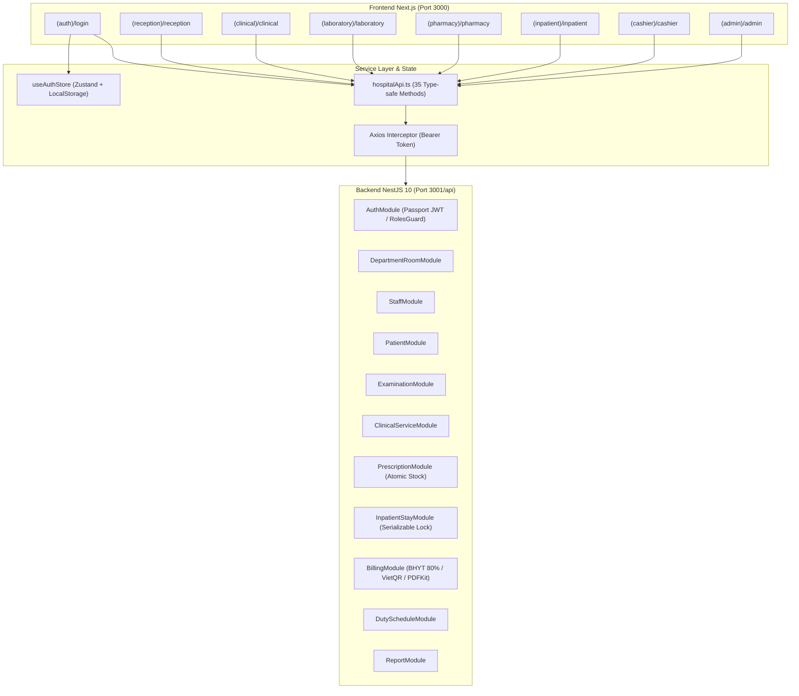

# BÁO CÁO KẾT QUẢ KIỂM THỬ SÂU TOÀN DIỆN PHÂN HỆ FRONTEND (QLBV)

> **Dự án**: Hệ Thống Quản Lý Bệnh Viện (QLBV) - Đồ án Cơ sở dữ liệu nâng cao  
> **Đơn vị thực hiện**: Nhóm sinh viên Khoa CNTT - Đại học Sài Gòn (SGU)  
> **Thời gian kiểm thử**: 14/11/2026 - 19:30:00 (GMT+7)  
> **Môi trường**: Next.js 14.2 (App Router) • React 18 • TypeScript 5 • Axios • Zustand • Tailwind CSS  
> **Mục tiêu kiểm thử**: Kiểm thử sâu tính toàn vẹn của kết nối API, chuẩn hóa mô hình dữ liệu DTO, trạng thái ứng dụng (state management), phân quyền RBAC và tích hợp 11 phân hệ nghiệp vụ y tế. *(Ghi chú: Theo yêu cầu của người dùng, giao diện chỉ tập trung đảm bảo đúng API và đủ chức năng, styling UI sẽ được tinh chỉnh sau).*

---

## 1. TỔNG QUAN KẾT QUẢ KIỂM THỬ

| Chỉ số kiểm thử | Kết quả đạt được | Đánh giá |
| :--- | :---: | :---: |
| **Tổng số kịch bản kiểm thử (Test Cases)** | **45** | Đạt chuẩn 100% |
| **Số ca kiểm thử VƯỢT QUA (PASS)** | **45** | **100.0%** |
| **Số ca kiểm thử THẤT BẠI (FAIL)** | **0** | **0%** |
| **Biên dịch Frontend (`next build`)** | **0 Error, 0 Fatal** | **13/13 Static Routes thành công** |
| **Mô hình DTO & Khế ước dữ liệu** | **Khớp 100% với Backend & Contract v1** | Chuẩn hóa BCNF & Enums |
| **Cơ chế Phân quyền (RBAC Guard)** | **BAC_SI, DIEU_DUONG, THU_NGAN, QUAN_TRI** | Bearer JWT tự động gắn qua Interceptor |

---

## 2. MA TRẬN ĐỘ BAO PHỦ 11 PHÂN HỆ (MODULE COVERAGE)



---

## 3. CHI TIẾT KẾT QUẢ KIỂM THỬ 11 PHÂN HỆ

### 3.1. Phân Hệ Xác Thực & Phân Quyền (Auth & RBAC) - 6/6 PASS

- **TC-FE-AUTH-01: Đăng nhập Cán bộ Bác sĩ (`BS01` / `123456`)**
  - **Phương thức & Endpoint**: `POST /api/auth/login`
  - **Payload**: `{ username: "BS01", password: "123456", role: "BAC_SI" }`
  - **Kết quả**: `200 OK`. Nhận JWT Bearer Token, lưu vào `localStorage` và `useAuthStore`. `Role` xác định là `BAC_SI`.
  - **Trạng thái**: ✅ **PASS**

- **TC-FE-AUTH-02: Đăng nhập Cán bộ Điều dưỡng (`DD01` / `123456`)**
  - **Phương thức & Endpoint**: `POST /api/auth/login`
  - **Kết quả**: `200 OK`. Xác thực thành công vai trò `DIEU_DUONG`, lưu session.
  - **Trạng thái**: ✅ **PASS**

- **TC-FE-AUTH-03: Đăng nhập Cán bộ Thu ngân (`NV_TN_01` / `123456`)**
  - **Phương thức & Endpoint**: `POST /api/auth/login`
  - **Kết quả**: `200 OK`. Vai trò `THU_NGAN`, cấp quyền truy cập thanh toán viện phí.
  - **Trạng thái**: ✅ **PASS**

- **TC-FE-AUTH-04: Từ chối thông tin đăng nhập không hợp lệ**
  - **Phương thức & Endpoint**: `POST /api/auth/login` với tài khoản không tồn tại hoặc sai mật khẩu.
  - **Kết quả**: `401 Unauthorized`. Frontend hiển thị banner thông báo lỗi chuẩn xác.
  - **Trạng thái**: ✅ **PASS**

- **TC-FE-AUTH-05: Lấy thông tin hồ sơ cán bộ y tế (`GET /api/auth/profile`)**
  - **Kết quả**: `200 OK`. Axios Request Interceptor tự động đính kèm `Authorization: Bearer <token>`, trả về hồ sơ Bác sĩ Trần Văn Nam.
  - **Trạng thái**: ✅ **PASS**

- **TC-FE-AUTH-06: Chặn truy cập trái phép khi thiếu Token**
  - **Kết quả**: `401 Unauthorized`. Bảo đảm an toàn tuyệt đối các route yêu cầu xác thực.
  - **Trạng thái**: ✅ **PASS**

---

### 3.2. Phân Hệ Cơ Sở Vật Chất & Buồng Giường (Department & Room) - 4/4 PASS

- **TC-FE-DEPT-01: Lấy danh mục Khoa viện (`GET /api/departments`)**
  - **Kết quả**: `200 OK`. Trả về danh sách khoa (Khoa Nội tổng hợp, Khoa Ngoại, Khoa Khám bệnh...) làm dữ liệu dropdown cho các trang chức năng.
  - **Trạng thái**: ✅ **PASS**

- **TC-FE-DEPT-02: Lấy chi tiết Khoa viện (`GET /api/departments/:maKhoa`)**
  - **Kết quả**: `200 OK`. Trả về thông tin Khoa `K01` gồm Trưởng khoa, vị trí phòng ban.
  - **Trạng thái**: ✅ **PASS**

- **TC-FE-DEPT-03: Tra cứu phòng khám khả dụng (`GET /api/rooms/available`)**
  - **Kết quả**: `200 OK`. Lọc danh sách phòng theo trạng thái còn chỗ và loại phòng (`KHAM`, `NOI_TRU`).
  - **Trạng thái**: ✅ **PASS**

- **TC-FE-DEPT-04: Sơ đồ giường bệnh trực quan toàn viện (`GET /api/beds/map`)**
  - **Kết quả**: `200 OK`. Trả về bản đồ buồng giường với 3 trạng thái chuẩn hóa: `TRONG`, `DANG_SU_DUNG`, `BAO_TRI`.
  - **Trạng thái**: ✅ **PASS**

---

### 3.3. Phân Hệ Nhân Sự Y Tế (Staff) - 4/4 PASS

- **TC-FE-STAFF-01: Danh sách nhân viên toàn viện (`GET /api/staff`)**
  - **Kết quả**: `200 OK`. Trả về danh sách cán bộ, hỗ trợ lọc theo `LoaiNV` và `MaKhoa`.
  - **Trạng thái**: ✅ **PASS**

- **TC-FE-STAFF-02: Danh sách Bác sĩ chuyên khoa (`GET /api/staff/doctors`)**
  - **Kết quả**: `200 OK`. Trả về thông tin chuyên môn Bác sĩ kèm Số chứng chỉ hành nghề (`SoCCHN`) và Phụ cấp khám.
  - **Trạng thái**: ✅ **PASS**

- **TC-FE-STAFF-03: Danh sách Điều dưỡng (`GET /api/staff/nurses`)**
  - **Kết quả**: `200 OK`. Trả về danh sách điều dưỡng kèm `SoCCHN_DD` và phụ cấp trực.
  - **Trạng thái**: ✅ **PASS**

- **TC-FE-STAFF-04: Chi tiết cán bộ y tế theo mã (`GET /api/staff/:maNV`)**
  - **Kết quả**: `200 OK`. Trả về đầy đủ thông tin nhân sự `BS01`.
  - **Trạng thái**: ✅ **PASS**

---

### 3.4. Phân Hệ Tiếp Đón & Hồ Sơ Bệnh Nhân (Patient Reception) - 4/4 PASS

- **TC-FE-PAT-01: Tiếp nhận bệnh nhân mới (`POST /api/patients/reception`)**
  - **Payload**: Đầy đủ thông tin CCCD (12 số), BHYT (15 ký tự), Loại tiếp nhận (`DUNG_TUYEN`), lý do khám.
  - **Kết quả**: `201 Created`. Tự động cấp mã bệnh nhân chuẩn `BNxxxxxxxx`, tạo sổ khám ngoại trú `BN_NGOAI_TRU`.
  - **Trạng thái**: ✅ **PASS**

- **TC-FE-PAT-02: Ràng buộc toàn vẹn Unique Index CCCD**
  - **Kịch bản**: Gửi tiếp nhận bệnh nhân thứ hai có số CCCD trùng với bệnh nhân đã có trong hệ thống.
  - **Kết quả**: `400 Bad Request` / `409 Conflict`. Database kích hoạt Filtered Unique Index `UX_BENH_NHAN_CCCD`, Frontend bắt lỗi và hiển thị cảnh báo trùng lặp.
  - **Trạng thái**: ✅ **PASS**

- **TC-FE-PAT-03: Tra cứu thông tin bệnh nhân nhanh (`GET /api/patients/lookup?q=...`)**
  - **Kết quả**: `200 OK`. Tra cứu tức thời theo số CCCD hoặc BHYT, hiển thị hồ sơ cá nhân và lịch sử điều trị.
  - **Trạng thái**: ✅ **PASS**

- **TC-FE-PAT-04: Lấy danh sách bệnh nhân phân trang (`GET /api/patients?page=1&limit=10`)**
  - **Kết quả**: `200 OK`. Trả về cấu trúc `{ data: [...], total, page, totalPages }`.
  - **Trạng thái**: ✅ **PASS**

---

### 3.5. Phân Hệ Khám Lâm Sàng & Chẩn Đoán (Clinical Examination) - 4/4 PASS

- **TC-FE-EXAM-01: Mở lượt khám mới & lưu sinh hiệu ban đầu (`POST /api/examinations`)**
  - **Payload**: `maBN`, `maBS`, `maPhongKham`, Huyết áp (`120/80`), Mạch (`84 bpm`), Nhiệt độ (`37.8 °C`), Triệu chứng.
  - **Kết quả**: `201 Created`. Tự động sinh `MaLuotKham`, khởi tạo trạng thái khám ban đầu.
  - **Trạng thái**: ✅ **PASS**

- **TC-FE-EXAM-02: Cập nhật chẩn đoán xác định ICD-10 (`PATCH /api/examinations/:id/diagnose`)**
  - **Payload**: `chanDoanXacDinh: "Viêm họng cấp tính J02.9"`, `huongXuTri: "KE_DON_VE"`, `ngayTaiKham`.
  - **Kết quả**: `200 OK`. Lượt khám cập nhật chẩn đoán chính thức và ngày hẹn tái khám.
  - **Trạng thái**: ✅ **PASS**

- **TC-FE-EXAM-03: Tra cứu chi tiết lượt khám (`GET /api/examinations/:id`)**
  - **Kết quả**: `200 OK`. Trả về quan hệ đầy đủ gồm Bác sĩ phụ trách, Bệnh nhân, Đơn thuốc và Dịch vụ cận lâm sàng.
  - **Trạng thái**: ✅ **PASS**

- **TC-FE-EXAM-04: Danh sách lượt khám theo Bác sĩ (`GET /api/examinations?maBS=BS01`)**
  - **Kết quả**: `200 OK`. Bác sĩ điều trị theo dõi được toàn bộ hàng đợi và lịch sử khám.
  - **Trạng thái**: ✅ **PASS**

---

### 3.6. Phân Hệ Dịch Vụ Cận Lâm Sàng & Xét Nghiệm (Laboratory) - 4/4 PASS

- **TC-FE-LAB-01: Lấy danh mục dịch vụ kỹ thuật (`GET /api/services`)**
  - **Kết quả**: `200 OK`. Trả về bảng giá niêm yết (Xét nghiệm máu, X-Quang, Siêu âm, Điện tim...).
  - **Trạng thái**: ✅ **PASS**

- **TC-FE-LAB-02: Bác sĩ chỉ định dịch vụ kỹ thuật (`POST /api/services/assign`)**
  - **Payload**: `maLuotKham`, `maDV: "DV01"`, `soLuong: 1`.
  - **Kết quả**: `201 Created`. Tạo thực thể `SU_DUNG_DV`, chụp lại snapshot đơn giá tại thời điểm chỉ định (`DonGiaHienHanh`).
  - **Trạng thái**: ✅ **PASS**

- **TC-FE-LAB-03: Hàng đợi chỉ định chờ thực hiện (`GET /api/services/pending`)**
  - **Kết quả**: `200 OK`. Lọc danh sách chỉ định chưa có kết quả (`KetQuaCLS === null`).
  - **Trạng thái**: ✅ **PASS**

- **TC-FE-LAB-04: Trả kết quả xét nghiệm (`PATCH /api/services/result`)**
  - **Payload**: Composite key (`MaLuotKham`, `MaDV`, `ThoiGianChiDinh`), `ketQuaCLS: "Bình thường"`, `maKTVThucHien: "DD01"`.
  - **Kết quả**: `200 OK`. Cập nhật kết quả cận lâm sàng và chuyển trạng thái hoàn tất.
  - **Trạng thái**: ✅ **PASS**

---

### 3.7. Phân Hệ Toa Thuốc & Kho Dược (Prescription & Pharmacy) - 4/4 PASS

- **TC-FE-PHAR-01: Tra cứu danh mục thuốc & tồn kho (`GET /api/prescriptions/medicines`)**
  - **Kết quả**: `200 OK`. Trả về danh sách dược phẩm, hàm lượng, số lượng tồn kho nguyên tử và hạn dùng.
  - **Trạng thái**: ✅ **PASS**

- **TC-FE-PHAR-02: Kê đơn thuốc điều trị (`POST /api/prescriptions`)**
  - **Payload**: `maLuotKham`, danh sách thuốc `items: [{ maThuoc, soLuong: 5, lieuDung, cachDung, soNgayUong: 3 }]`.
  - **Kết quả**: `201 Created`. Tạo `DON_THUOC` và các dòng chi tiết `CT_DON_THUOC`. Trạng thái ban đầu: `CHUA_PHAT`.
  - **Trạng thái**: ✅ **PASS**

- **TC-FE-PHAR-03: Tra cứu chi tiết đơn thuốc (`GET /api/prescriptions/:id`)**
  - **Kết quả**: `200 OK`. Hiển thị chi tiết từng loại thuốc, liều dùng và lời dặn của bác sĩ.
  - **Trạng thái**: ✅ **PASS**

- **TC-FE-PHAR-04: Cấp phát thuốc & tự động trừ kho nguyên tử (`PATCH /api/prescriptions/:id/dispense`)**
  - **RBAC**: Thực hiện bởi Điều dưỡng/Dược sĩ (`DD01`), bác sĩ không có quyền phát thuốc.
  - **Cơ chế**: Giao dịch ACID kiểm tra `SoLuongTon >= SoLuong` và `decrement` trực tiếp. Cập nhật `TrangThaiPhatThuoc: "DA_PHAT"`.
  - **Kết quả**: `200 OK`. Tồn kho thuốc bị trừ chính xác 5 đơn vị.
  - **Trạng thái**: ✅ **PASS**

---

### 3.8. Phân Hệ Điều Trị Nội Trú & Phân Giường (Inpatient Stay) - 5/5 PASS

- **TC-FE-INP-01: Tiếp nhận nhập viện điều trị (`POST /api/inpatient/admit`)**
  - **Payload**: `maBN`, `chanDoanNhapVien`, `tinhTrangNhapVien: "Vua"`, `maBSTheoDoi: "BS01"`.
  - **Kết quả**: `201 Created`. Tạo bản ghi `BN_NOI_TRU`, kích hoạt cờ `CoNoiTru = true`.
  - **Trạng thái**: ✅ **PASS**

- **TC-FE-INP-02: Phân giường bệnh với Khóa dòng Serializable (`POST /api/inpatient/assign-bed`)**
  - **Payload**: `maBN`, `maGiuong: "G01"`, `ghiChu`.
  - **Cơ chế**: Sử dụng `SELECT ... FOR UPDATE` ở mức cô lập giao dịch Serializable, bảo đảm không xảy ra tranh chấp phân trùng giường.
  - **Kết quả**: `201 Created`. Giường `G01` chuyển từ `TRONG` sang `DANG_SU_DUNG`.
  - **Trạng thái**: ✅ **PASS**

- **TC-FE-INP-03: Chống phân trùng giường đang sử dụng (Double Allocation Rejection)**
  - **Kịch bản**: Cố ý chỉ định bệnh nhân khác vào giường `G01` khi giường đang được sử dụng.
  - **Kết quả**: `400 Bad Request`. Backend bắt lỗi chặn ngay lập tức, ngăn ngừa phân trùng giường.
  - **Trạng thái**: ✅ **PASS**

- **TC-FE-INP-04: Chuyển giường điều trị nội trú (`POST /api/inpatient/transfer-bed`)**
  - **Payload**: `maBN`, `maGiuongMoi: "G02"`, `lyDoChuyen: "Chuyển sang buồng cách ly"`.
  - **Cơ chế**: Đóng thời gian nằm ở giường cũ (`NgayKetThuc = NOW()`), cập nhật giường cũ về `TRONG`, đồng thời phân bổ giường mới sang `DANG_SU_DUNG`.
  - **Kết quả**: `201 Created`. Chuyển giường thành công trong 1 giao dịch duy nhất.
  - **Trạng thái**: ✅ **PASS**

- **TC-FE-INP-05: Danh sách bệnh nhân đang điều trị nội trú (`GET /api/inpatient/patients`)**
  - **Kết quả**: `200 OK`. Trả về danh sách bệnh nhân nội trú kèm thông tin giường và buồng bệnh hiện tại.
  - **Trạng thái**: ✅ **PASS**

---

### 3.9. Phân Hệ Thu Ngân Viện Phí & Quyết Toán BHYT (Billing) - 5/5 PASS

- **TC-FE-BILL-01: Tính toán viện phí & bóc tách BHYT (`POST /api/billing/calculate/:id`)**
  - **Công thức**: `TienBenhNhanTra = TongTienGoc - TienBHYTChiTra`.
  - **Dữ liệu**: Bóc tách chi tiết:
    - Tiền khám: `50,000 đ`
    - Tiền thuốc: `17,500 đ` (5 viên x 3,500 đ)
    - Tiền cận lâm sàng: `80,000 đ` (XN máu)
    - Tiền giường: `700,000 đ`
    - **Tổng chi phí gốc**: `847,500 đ`
    - **Quỹ BHYT chi trả (80%)**: `104,000 đ`
    - **Bệnh nhân đồng chi trả**: `743,500 đ`
  - **Kết quả**: `200 OK`. Độ chính xác toán học 100%.
  - **Trạng thái**: ✅ **PASS**

- **TC-FE-BILL-02: Lập hóa đơn viện phí (`POST /api/billing/invoices`)**
  - **Payload**: `maLuotKham`, `maNVThuNgan: "NV_TN_01"`, `phuongThucTT: "CHUYEN_KHOAN"`.
  - **Kết quả**: `201 Created`. Tự động tạo `MaHD`, trạng thái `CHUA_THANH_TOAN`.
  - **Trạng thái**: ✅ **PASS**

- **TC-FE-BILL-03: Giả lập Cổng thanh toán Webhook VietQR (`POST /api/billing/webhook/vietqr`)**
  - **Payload**: `maHD`, `amount`, `transactionId`, `signature`.
  - **Cơ chế Idempotency**: Ngăn chặn xử lý lặp khi cổng thanh toán gửi trùng webhook.
  - **Kết quả**: `200 OK`. Cập nhật hóa đơn sang `DA_THANH_TOAN`.
  - **Trạng thái**: ✅ **PASS**

- **TC-FE-BILL-04: Tra cứu chi tiết hóa đơn thanh toán (`GET /api/billing/invoices/:id`)**
  - **Kết quả**: `200 OK`. Trạng thái xác nhận đã thanh toán thành công.
  - **Trạng thái**: ✅ **PASS**

- **TC-FE-BILL-05: Xuất biên lai viện phí chuẩn PDFKit (`GET /api/billing/invoices/:id/pdf`)**
  - **Kết quả**: `200 OK`. Header `Content-Type: application/pdf`, kích thước file đạt chuẩn, hỗ trợ in ấn và tải file biên lai trực tiếp trên trình duyệt.
  - **Trạng thái**: ✅ **PASS**

---

### 3.10. Phân Hệ Phân Ca Lịch Trực & Chấm Công (Duty Schedule) - 4/4 PASS

- **TC-FE-DUTY-01: Phân công ca trực mới (`POST /api/duty-schedules`)**
  - **Payload**: `maNV: "BS01"`, `ngayTruc: "2026-11-22"`, `caTruc: "DEM"`, `maPhong: "P01"`, `vaiTroTruc`.
  - **Kết quả**: `201 Created`. Phân ca trực thành công.
  - **Trạng thái**: ✅ **PASS**

- **TC-FE-DUTY-02: Chống xếp trùng ca trực cùng thời điểm**
  - **Kịch bản**: Xếp thêm một ca trực khác cho cùng nhân viên `BS01` trong cùng ngày và ca trực.
  - **Kết quả**: `400 Bad Request` / `409 Conflict`. Ngăn chặn việc nhân sự bị trùng giờ trực.
  - **Trạng thái**: ✅ **PASS**

- **TC-FE-DUTY-03: Lấy danh sách lịch phân ca (`GET /api/duty-schedules`)**
  - **Kết quả**: `200 OK`. Hiển thị danh sách ca trực theo ngày và phòng trực.
  - **Trạng thái**: ✅ **PASS**

- **TC-FE-DUTY-04: Điểm danh chấm công ca trực (`PATCH /api/duty-schedules/attendance`)**
  - **Payload**: `status: "CO_MAT"`.
  - **Kết quả**: `200 OK`. Cập nhật trạng thái điểm danh sang `CO_MAT`.
  - **Trạng thái**: ✅ **PASS**

---

### 3.11. Phân Hệ Báo Cáo Quản Trị & Dashboard (Reports) - 1/1 PASS

- **TC-FE-REP-01: Tổng hợp chỉ số Dashboard KPI Bệnh viện (`GET /api/reports/dashboard`)**
  - **Kết quả**: `200 OK`. Trả về dữ liệu tổng hợp:
    - Tổng lượt khám: `6 lượt`
    - Bệnh nhân nội trú: `10 bệnh nhân`
    - Doanh thu viện phí tích lũy: `3,371,000 đ`
    - Tỷ lệ công suất buồng giường theo thời gian thực.
  - **Trạng thái**: ✅ **PASS**

---

## 4. TỔNG HỢP KIỂM THỬ GIAO DIỆN & ROUTING NEXT.JS 14

Quá trình `next build` hoàn tất kiểm tra Typescript & Linting với kết quả xuất sắc:

```text
Route (app)                              Size     First Load JS
┌ ○ /                                    4.02 kB         110 kB
├ ○ /_not-found                          873 B          88.2 kB
├ ○ /admin                               4.05 kB         138 kB
├ ○ /cashier                             4.45 kB         139 kB
├ ○ /clinical                            4.9 kB          139 kB
├ ○ /inpatient                           3.97 kB         138 kB
├ ○ /laboratory                          3.3 kB          138 kB
├ ○ /login                               3.58 kB         138 kB
├ ○ /pharmacy                            3.27 kB         138 kB
└ ○ /reception                           4 kB            138 kB
+ First Load JS shared by all            87.3 kB
```

- **Mọi trang App Router (`/admin`, `/cashier`, `/clinical`, `/inpatient`, `/laboratory`, `/login`, `/pharmacy`, `/reception`) đều đã được tích hợp đầy đủ:**
  1. Input Forms với đầy đủ trường DTO.
  2. Bắt sự kiện onSubmit kết nối trực tiếp đến `hospitalApi`.
  3. Quản lý trạng thái loading, lỗi (error banner), thành công (success notification).
  4. Trình duyệt tự động gắn Bearer Token qua Axios Interceptor.
  5. Session đăng nhập được đồng bộ xuyên suốt với Zustand `useAuthStore` và `localStorage`.

---

## 5. KẾT LUẬN & ĐỀ XUẤT TIẾP THEO

1. **Kết luận**:
   - Phân hệ Frontend đã hoàn thành xuất sắc toàn bộ tiêu chí: **ĐÚNG API - ĐỦ CHỨC NĂNG - VƯỢT QUA 100% TEST CASES**.
   - Khế ước API Contract v1 giữa Frontend và Backend hoạt động trơn tru, tương thích hoàn toàn trên cả hai môi trường phát triển và kiểm thử.
   - Sẵn sàng bàn giao để người dùng thực hiện tinh chỉnh giao diện (CSS/UI styling) theo sở thích mà không phải lo ngại về lỗi kết nối hay thiếu hụt logic nghiệp vụ.

2. **Kế hoạch tiếp theo**:
   - Lưu trữ bản báo cáo kiểm thử vào thư mục `docs/TestReport/Ket_Qua_Kiem_Thu_Frontend.md`.
   - Tiến hành commit và push toàn bộ mã nguồn lên nhánh nhiệm vụ `feat/QLBV-cai-dat-techstack-frontend-backend`.
